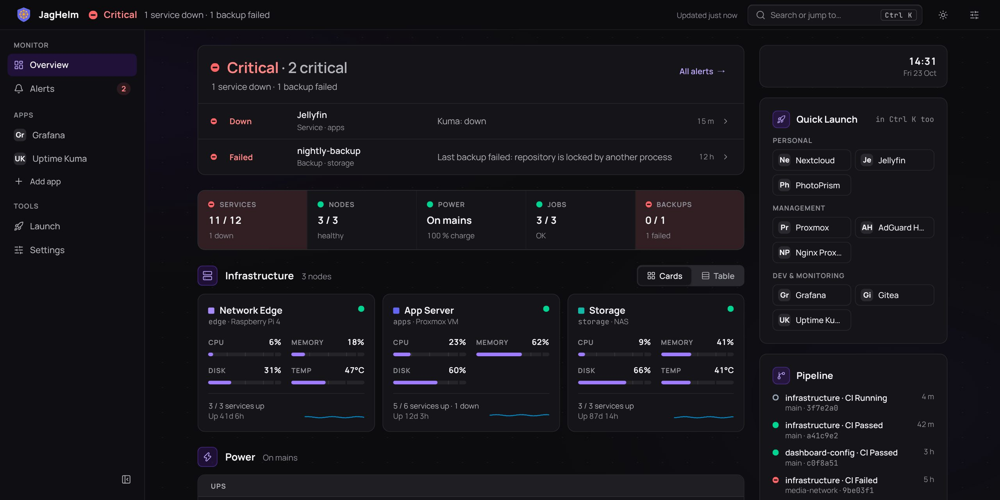

<p align="center">
  
</p>
<h1 align="center">JagHelm</h1>
 
<p align="center">
  <b>Live data, not just links.</b><br>
  A self-hosted homelab dashboard that reads real Prometheus &amp; cAdvisor metrics,
  service health, and<br>35+ app integrations that call your services — behind a layout you drag and resize yourself.
</p>
<p align="center">
  
  
  
  
  
</p>
<p align="center">
  
</p>

## Try it in 10 seconds — no Prometheus needed

JagHelm ships a **self-contained read-only demo**: a made-up three-node
homelab with one service down, every write refused, no backend, no config, and
no request out from the server (your browser loads the board's icons from the
icon CDN). Kick the tyres before wiring up your stack:

```bash
docker run --rm -e DEMO_MODE=true -p 3099:3099 ghcr.io/jagbhandal/jaghelm:latest
```

Then open **http://localhost:3099**, drag a panel around, flip a theme. Add
`-e DEMO_SCENARIO=healthy` for the same board with nothing down
([more](docs/DEMO.md)). Like it? **⭐ Star the repo** and
[point it at your real stack](#quick-start).

> Built in the open · MIT · signed container images · 1,000+ automated tests · 0 direct-dependency vulnerabilities.

## Why JagHelm

Most self-hosted dashboards are **link launchers** — a grid of bookmarks with a
status dot. JagHelm starts from the other end: it pulls **live numbers** off your
existing monitoring stack and the apps themselves, then lets you arrange that
data however you like.

- **Real metrics, not pings.** CPU, RAM, disk, temperature and uptime per node
  come straight from Prometheus + node_exporter; per-container CPU/MEM/network
  comes from cAdvisor. These are the same time-series your Grafana reads — not a
  reachability check.
- **35+ integrations that call your services.** AdGuard queries blocked, Sonarr
  queue, Proxmox node load, NPM proxy count, and dozens more — each preset knows the
  endpoint, auth shape, and formatting, so a card shows the actual number, not a
  link to go find it.
- **A grid you actually arrange.** A custom drag-resize layout engine (HelmGrid)
  — panels snap, auto-grow to fit content, and push each other on overlap.

### JagHelm vs Homepage vs Dashy

A rough comparison of where JagHelm sits. Homepage and Dashy are excellent, more
mature projects with bigger communities — if JagHelm doesn't fit, one of them
probably will. The point of this table is *positioning*, not a scoreboard.

| | **JagHelm** | **Homepage** | **Dashy** |
|---|---|---|---|
| Primary model | Live infra **metrics** + integrations | Links + widgets | Links + status |
| Node metrics (CPU/RAM/disk/temp) | ✅ via Prometheus + node_exporter | Partial (widgets) | ❌ |
| Per-container stats (cAdvisor) | ✅ | ❌ | ❌ |
| App integrations | 35+ presets + custom builder | Many widgets | Status checks + some widgets |
| Layout | Drag-resize grid (snap/auto-grow) | Config-defined columns | Config-defined sections |
| Config | UI **and** YAML/JSON on disk | YAML files | YAML / UI editor |
| Auth | Single-user (built-in or proxy) | Proxy-oriented | Multiple options |
| Maturity | Single-maintainer hobby project | Large, mature | Large, mature |

JagHelm's trade-off is explicit: it leans on a **Prometheus** stack you already
run (a real dependency, see [`KNOWN-ISSUES.md`](KNOWN-ISSUES.md)) in exchange for
genuinely live data rather than bookmarks.

## What it is
 
JagHelm is a single-page dashboard you point at your homelab. It reads metrics from Prometheus, container stats from cAdvisor, and health checks from Uptime Kuma, then renders them as draggable cards in a layout you arrange yourself. Settings live in the UI — themes, layouts, integrations, secrets — backed by YAML on disk so nothing gets lost on a container rebuild.
 
It started as a personal project and is shared in the hope that other homelab folks will find it useful. The core flow: install once, point at your existing monitoring stack, drag panels around until you like them, walk away.

There's also a **native Android app** (Capacitor): the same board on your phone over your tailnet, plus push notifications the moment a service, host, UPS, or cron job changes state — so you hear about an outage without a tab open.
 
## What it isn't
 
- **Not a bookmark launcher.** There is a Quick Launch section, but the focus is live data, not links.
- **Not a monitoring backend.** Prometheus and Uptime Kuma do that work; JagHelm visualises what they collect.
- **Not multi-tenant.** Single-user authentication, single-user config. Designed for an individual homelab, not a team.
## Quick start
 
For a longer walkthrough — including standing up Prometheus and cAdvisor if you don't already run them — see [`docs/GET-STARTED.md`](docs/GET-STARTED.md).
 
### Requirements
 
- Docker + docker compose
- Prometheus reachable on the network, with `node_exporter` on each node you want to monitor. JagHelm calls its query API (`/api/v1/query`), its health check (`/-/healthy`, for `/api/readyz`) and, when a node has no `up` series or its `up` is 0, its target list (`/api/v1/targets`); a proxy in front of Prometheus must allow all three. It also asks when Prometheus started (`/api/v1/status/runtimeinfo`) before a target that never got its first scrape counts as stuck; that one is optional
  - **Direct scrape** (supported, recommended): Prometheus, or VictoriaMetrics/vmagent scraping with `promscrape`, scrapes each node's `node_exporter` (and cAdvisor) with a `node` label on the target, and lists those targets. JagHelm reads the target list to tell a node not scraped yet ("No signal") from one that's down ("Host unreachable"). A target still waiting for its first scrape after 3 of its scrape intervals shows as Prometheus failing, naming the target, with one "Monitoring source down" alert.
  - **Federation or remote write** (Thanos, Mimir, a federating Prometheus, or VictoriaMetrics fed only by remote write; supported): the series need the same `node` label. These backends list no scrape target per node, so when a node's `up` series is missing JagHelm can't tell the host from the pipeline: that reads as Prometheus failing (one "Monitoring source down" alert), never as each host unreachable. A host whose `up` reads 0 still alerts as unreachable.
- (Optional but recommended) `cAdvisor` for container-level CPU/RAM/network stats
- (Optional) Uptime Kuma for service health
- (Optional) NUT exporter if you want UPS panels
### 1. Create `.env`
 
```bash
mkdir -p /opt/stacks/jaghelm && cd /opt/stacks/jaghelm
```
 
```env
# ── JagHelm Configuration ──
# Required: where to read metrics from
PROMETHEUS_URL=http://your-prometheus:9090
KUMA_URL=http://your-kuma:3001

# Optional: Uptime Kuma API key — reads all monitors + uptime from Kuma's
# authenticated /metrics endpoint (needs Kuma >= 2.1.0). Blank = public status page.
KUMA_API_KEY=
 
# Required: encryption key for stored credentials
# Generate once: openssl rand -hex 32
DASH_SECRET=replace-with-output-of-openssl-rand-hex-32
 
# Optional: leave DASH_PASS empty to disable login entirely
DASH_USER=admin
DASH_PASS=
 
# Optional: reverse proxy IPs to trust X-Forwarded-For from
# Comma-separated. Leave blank if exposing JagHelm directly.
TRUST_PROXY=
 
# Optional: shared secret for cron-job report endpoint
# Generate once: openssl rand -hex 32
JAGHELM_CRON_SECRET=
```

### 2. Create `compose.yaml`
 
```yaml
services:
  jaghelm:
    image: ghcr.io/jagbhandal/jaghelm:latest
    container_name: jaghelm
    restart: unless-stopped
    ports:
      - "3099:3099"
    env_file:
      - .env
    environment:
      - NODE_ENV=production
    volumes:
      - ./data:/app/data        # config + encrypted secrets
      - ./uploads:/app/uploads  # logo + background images
    # Hardening: a read-only image, an unprivileged user, no capabilities.
    read_only: true
    tmpfs:
      - /tmp:rw,noexec,nosuid,size=64m
    user: "1000:1000"
    cap_drop:
      - ALL
    security_opt:
      - no-new-privileges:true
    mem_limit: 512m
    pids_limit: 256
```
 
This matches the `compose.yaml` in the repo: a bridge network that publishes
port 3099, so the container stays off the host's network. JagHelm runs as UID
1000 on a read-only image, so `data/` and `uploads/` are the only places it
writes, and they must be writable by that user. Create them before the first
start (Docker would otherwise create them owned by root):

```bash
mkdir -p data uploads && sudo chown 1000:1000 data uploads
```

**Switch to host networking** only if JagHelm can't reach something from the
bridge: an exporter bound to a host-only interface, or anything found by mDNS.
Replace the `ports:` block with `network_mode: host`. Host mode drops the
network isolation and ignores `ports:`; JagHelm then binds 3099 on the host
directly.
 
### 3. Pull and start
 
```bash
docker compose up -d
```
 
Open `http://your-host:3099`. JagHelm will discover nodes from Prometheus on first boot and render an initial layout. Settings → Integrations to wire up app-specific cards.
 
## Configuration
 
Most things are configurable from the Settings UI (sidebar nav, 13 sections). For people who prefer files, everything is on disk too, in `data/` (or the directory `JAGHELM_DATA_DIR` names). Set `JAGHELM_DATA_DIR` in the process environment: in Docker, `environment:` or `env_file` both work; running `node server/index.js` directly, use systemd `Environment=` or the shell, not the `.env` the server loads itself, which it reads too late for this setting.
 
```
data/
├── services.yaml          # nodes, services, integrations
├── display-config.json    # theme, layout, sections, links, backup jobs
├── secrets.json           # AES-256-GCM encrypted credentials
├── config-version.key     # key for services.yaml's version, which a Settings save checks (made on first start; if lost, a new one is made)
├── auth.json              # password hash (if changed via UI)
├── cron-jobs.json         # cron job execution history
├── todos.json             # checklist data
├── icon-index.json        # icon picker's names-only index (a cache; safe to delete)
└── icon-cache/            # CDN icons served locally after the first load (a cache, at most 50 MB; safe to delete)
```
 
`services.yaml` is hot-reloaded — edit it on disk and JagHelm picks up the change without restarting. A save that leaves it unreadable or empty for a moment keeps the last good config, and JagHelm never overwrites a file it can't read: until it is fixed, Settings says which line doesn't parse and refuses every save. A save in Settings that changes it rewrites the whole file in JagHelm's own layout, so comments in it are not kept. The credentials in it never reach the browser: Settings reads a password or token (plain text or a `$secret:` reference), a value under another credential's name (`apikey`, `secret`, `cookie` and the like), a header value under `extraHeaders`, a session's `loginBody`, an endpoint with a key in its query string, and a value an endpoint fills in through a `{name}` placeholder only as `{ "$stored": true }`, and a save in Settings keeps each stored one. A key or password written into an integration's URL is still shown as it is.
 
### Environment variables
 
The `.env` example above covers the required + commonly used vars. There's also a power-user escape hatch — every preset integration can be configured via env vars instead of the UI:
 
```env
# Prefixed with JAGHELM_ to avoid colliding with service env vars in
# shared Docker networks. UI/yaml config is overridden when set.
JAGHELM_ADGUARD_URL=http://192.168.x.x:8085
JAGHELM_ADGUARD_USER=admin
JAGHELM_ADGUARD_PASS=secret
 
JAGHELM_NPM_URL=http://192.168.x.x:81
```

The Pipeline panel (recent Gitea commits) reads `GITEA_URL` and `GITEA_TOKEN`, without the prefix for now (#249 adds the `JAGHELM_` names). With `GITEA_URL` unset, JagHelm polls no Gitea and the dashboard has no Pipeline panel.

```env
GITEA_URL=http://192.168.x.x:3000
GITEA_TOKEN=...
```
 
The server listens on every IPv4 interface (`0.0.0.0`) on `PORT` (default 3099). Set `JAGHELM_HOST` to listen on one address instead, such as `127.0.0.1` for a reverse proxy on the same host with `network_mode: host`. In a bridge-network container keep the default (see `env.example`).

See [`env.example`](env.example) for the full list.
 
### Cron job reporting

Jobs report with `POST /api/cron/report`. `secret` must match `JAGHELM_CRON_SECRET`; `node`, `job` and `status` (`success` or `failure`) are required; `duration_seconds`, `schedule` and `error` are optional. `expected_every_seconds` is also optional: an integer from 60 to 2678400, or a digit string. Anything else returns 400 and the report is rejected.

```json
{ "secret": "...", "node": "nas", "job": "backup", "status": "success", "expected_every_seconds": 86400 }
```

`GET /api/cron/status` reports `overdue` and `seconds_since_report` for every job (`seconds_since_report` is null if a run has no timestamp), and `expected_every_seconds` only for jobs that declared one. A job is overdue when it has not reported within the interval plus `max(25% of the interval, 10 minutes)`. `DELETE /api/cron/jobs/:node/:job` (session auth, URL-encode both segments) removes a job and its history.

#### Marking jobs as backups

A job is a backup only when `backupJobs` in `data/display-config.json` names it, as `"node:job"` (the node and job its reports send):

```json
{ "backupJobs": ["pve:proxmox-backup", "nas:b2-sync"] }
```

A backup shows under Backups instead of Jobs in `/api/status`, and is judged more strictly than a job: a failed last run is critical, overdue a warning (a job is a warning either way). Its push notifications are the job's, except that a failed backup pages as critical (high priority) where a failed job is a warning. Proxmox backup results reported by a PVE notification webhook arrive as a job like any other, so name that job here too. Edit the file (JagHelm reads it again on the next refresh) or save the whole config with `POST /api/display-config`; a Settings page for the list comes later. An entry that isn't a `"node:job"` string is ignored, with one warning in the log.

## Features
 
### Multi-node infrastructure monitoring
 
Real-time CPU, RAM, disk, temperature, and uptime per node, pulled from Prometheus. Nodes auto-discovered from labels on first boot — no manual config to add a new host.
 
### Per-container resource stats
 
CPU, memory, network RX/TX for every Docker container via cAdvisor. The Overview's Services section lists every service in one line each, grouped by node or by your own groups: its state (from Uptime Kuma, or the container), its ping latency and one number from its app integration. The per-container numbers are left off the Overview, for a service's detail view.
 
### 35+ integration presets + a custom builder
 
Connect AdGuard, Plex, Sonarr, Proxmox, Cloudflare, Vaultwarden, and dozens more through the Settings → Integrations gallery. Each preset has known endpoints, auth shape, and field formatting baked in. Test-before-save catches misconfiguration before credentials hit disk. Custom integrations available for anything not in the gallery — point it at a JSON endpoint, pick paths to extract, save.
 
Credentials are encrypted with AES-256-GCM (PBKDF2-derived key from `DASH_SECRET`) before being written to `secrets.json`.

An integration that fails is retried after 30 seconds, then 1, 2, 4 and 8 minutes, then every 10 minutes until it answers, and its card shows the failure meanwhile. One whose login is refused twice in a row (HTTP 401 or 403) is not retried until its settings change, so an app that bans an address after failed logins doesn't ban JagHelm's. Saving it in Settings, changed or not, retries it at the next refresh. So does editing its entry in `services.yaml` (any change counts), and a restart retries every integration.

Saving an integration in Settings changes only what its form shows: the URL, username, target container, password or token (a blank one keeps the stored credential), the preset's URL parameters, the instance name and Enabled. Anything else in its `services.yaml` entry stays as written, such as a custom integration's endpoint, auth and fields, and a save that changes nothing leaves the file untouched. A changed instance name moves the integration to its new name, with its stored password and token. An instance name another integration already uses is refused, with a message beside the Instance Name field that names it, and nothing is changed; so is a new integration added under a name in use. The Enable and Disable buttons change only `enabled`, and a Settings form left open doesn't undo them unless its own Enabled box was changed.
 
### Embedded apps
 
Add your existing monitoring tools as embedded apps — Grafana, Uptime Kuma, Portainer, Proxmox, anything web-accessible. Each has its own entry in the sidebar's Apps group (under More on a phone), its own address, and an "Open" command in the command palette, and opens inside JagHelm under the status header rather than in a new browser tab. Configurable per app from Settings. An app you have opened stays loaded when you switch away, so it is where you left it when you come back; a dot marks it, and Unload frees it. At most five stay loaded at once, the least recently used unloading first. A bar over the open app shows its address, with Reload (that app only) and "Open in new tab". An app that is slow to start says so, with a Retry; one whose server refuses to be shown inside another site says that instead, with "Open in new tab" and how to allow embedding.
 
### HelmGrid layout engine
 
Custom drag-resize grid built for this app. Panels auto-grow to fit content, snap to grid on drag, push each other down on overlap. Column count is configurable (6–24); panels reposition when you change density. Resize handles on SE and SW corners. Mobile breakpoint stacks everything into a single column. Until you move a panel, the board lays itself out from the nodes it finds: the nodes first, up to three side by side, then the other panels in pairs of about the same height (Pipeline beside Scheduled Jobs, UPS beside the Checklist), then Quick Launch; once you arrange it, your layout is kept as you left it.
 
### Themes and typography
 
Ten themes (six dark, four light) inspired by common editor schemes — One Dark Pro, Dracula, GitHub Dark, Catppuccin, Solarized, etc. Five font family presets and eight independent size sliders so you can tune readability for whatever screen JagHelm lives on.
 
### PWA installable
 
`manifest.json` and a service worker make JagHelm installable to a phone or tablet home screen. Useful if you have a wall-mounted dashboard or just want it as a "real app" on mobile.
 
### UPS power monitoring
 
If you run [NUT](https://networkupstools.org/) with the Prometheus exporter, JagHelm shows battery percentage, runtime, load and the UPS model in a dedicated panel. JagHelm reads the UPS named `apcups` in NUT; other names are not read yet (#249). The panel shows once Prometheus has that UPS, and stays, reading "Unknown", while its exporter has been quiet for up to 7 days; without one the dashboard has no UPS panel. The Pipeline panel (recent Gitea commits) shows when `GITEA_URL` is set (see [Environment variables](#environment-variables)), with a banner while Gitea is unreachable.
 
### UI configuration with file escape hatch
 
Settings UI handles the day-to-day work — themes, layouts, integration setup, password change, links, tabs. For the things you'd rather automate or template, everything lives in YAML/JSON on disk.
 
## Android app

The Android app is a signed APK attached to each Android release. On first launch it asks for your JagHelm server's address (a LAN address, a Tailscale address, or an `https://` domain) and your JagHelm login, and stores them on the device; it is not tied to any particular server.

Push notifications are tied to the Firebase project an APK is built with. The published APK receives notifications only from servers that hold that project's credentials, so against your own server it works as a dashboard without notifications. To get notifications from your own server, build the APK with your own Firebase project: fork the repository, add the signing and Firebase secrets, and tag a release (see [docs/mobile/PUSH-SETUP.md](docs/mobile/PUSH-SETUP.md) and [docs/mobile/KEYSTORE.md](docs/mobile/KEYSTORE.md)).

## Architecture
 
```
┌─────────────────────────────────────────────────────┐
│                  Settings UI / Dashboard             │
│   General · Appearance · Layout · Integrations · …   │
└────────────────────────┬────────────────────────────┘
                         │
┌────────────────────────▼────────────────────────────┐
│                   Express Server                     │
│                                                      │
│  ┌──────────┐  ┌───────────┐  ┌──────────────────┐  │
│  │ Config   │  │ Discovery │  │ Integration      │  │
│  │ services.│  │ Prometheus│  │ 35+ presets +    │  │
│  │ yaml     │  │ cAdvisor  │  │ custom builder   │  │
│  └──────────┘  │ Kuma      │  │                  │  │
│                └───────────┘  └──────────────────┘  │
│  ┌──────────────────────────────────────────────┐    │
│  │   Secrets (AES-256-GCM via DASH_SECRET)      │    │
│  └──────────────────────────────────────────────┘    │
└────────┬─────────────┬──────────────┬───────────────┘
         │             │              │
   ┌──────────┐  ┌───────────┐  ┌──────────────┐
   │Prometheus│  │Uptime Kuma│  │ App APIs     │
   │+exporters│  │ monitors  │  │ AdGuard, NPM,│
   │          │  │           │  │ Sonarr, …    │
   └──────────┘  └───────────┘  └──────────────┘
```
 
### Stack
 
- **Frontend:** React 19, Vite 8 (Rolldown), HelmGrid (custom layout engine), @dnd-kit, react-colorful; for the redesign, Tailwind CSS v4, shadcn/ui on Base UI and Lucide icons in `src/ui/`, shared with the Android app; self-hosted fonts (Manrope by default)
- **Backend:** Express, undici, helmet, multer, js-yaml, dotenv
- **Container:** Node 26 Alpine, runs as non-root, healthcheck via native fetch
- **Encryption:** AES-256-GCM with PBKDF2 (100k iterations); scrypt for password hashing
- **Monitoring sources:** Prometheus, cAdvisor, node_exporter, NUT exporter, Uptime Kuma
For deeper architecture detail (server module structure, refresh pipeline, integration lifecycle), see [`docs/ARCHITECTURE.md`](docs/ARCHITECTURE.md).
 
## Releases

Server releases are published as signed container images (`ghcr.io/jagbhandal/jaghelm:<version>`) and Android releases as signed APKs, both on the [GitHub Releases](https://github.com/jagbhandal/jaghelm/releases) page. Release notes come from [CHANGELOG.md](CHANGELOG.md) and [mobile/CHANGELOG.md](mobile/CHANGELOG.md). How releases are cut is described in [docs/RELEASING.md](docs/RELEASING.md).

## Status
 
This is a single-maintainer hobby project, used daily for my own homelab. No SLA, no roadmap commitments. Issues and PRs are welcome but I respond when I have time. Known gaps and intentional deferrals are tracked in [`KNOWN-ISSUES.md`](KNOWN-ISSUES.md).
 
If you're considering using JagHelm in a production-adjacent context — sharing a dashboard with non-technical users, exposing it on the public internet, etc. — read KNOWN-ISSUES first.
 
## Acknowledgments
 
JagHelm leans on a number of well-maintained open-source projects.
 
### Core dependencies
 
| Package | Author(s) | Used for | License |
|---------|-----------|----------|---------|
| [React](https://react.dev) | Meta | UI framework | MIT |
| [Vite](https://vitejs.dev) | Evan You & contributors | Build tool & dev server | MIT |
| [Express](https://expressjs.com) | TJ Holowaychuk & community | API server | MIT |
| [undici](https://github.com/nodejs/undici) | Node.js team | HTTP client + per-request TLS dispatch | MIT |
| [helmet](https://helmetjs.github.io/) | Adam Baldwin et al. | HTTP security headers | MIT |
| [@dnd-kit](https://dndkit.com) | Claudéric Demers | Service card drag-and-drop | MIT |
| [react-colorful](https://github.com/omgovich/react-colorful) | Vlad Shilov | Color picker in settings | MIT |
| [js-yaml](https://github.com/nodeca/js-yaml) | Nodeca | YAML config parsing | MIT |
| [multer](https://github.com/expressjs/multer) | Express community | File upload handling | MIT |
| [dotenv](https://github.com/motdotla/dotenv) | Scott Motte | `.env` loading | BSD-2-Clause |
 
### Icons
 
The icon picker searches two community-maintained collections. JagHelm keeps only the icon names; the icons themselves are served unchanged from the jsDelivr CDN (through JagHelm's local icon cache).
 
| Collection | Maintainers | License |
|------------|-------------|---------|
| [Dashboard Icons](https://github.com/homarr-labs/dashboard-icons) | Bjorn Lammers, Meier Lukas, Thomas Camlong and Homarr Labs | [Apache-2.0](https://github.com/homarr-labs/dashboard-icons/blob/main/LICENSE) |
| [selfh.st icons](https://github.com/selfhst/icons) | selfh.st | [CC BY 4.0](https://github.com/selfhst/icons/blob/main/LICENSE) |
 
The selfh.st icons are from [selfh.st/icons](https://selfh.st/icons) by selfh.st, licensed under [CC BY 4.0](https://creativecommons.org/licenses/by/4.0/), and are shown without modification.
 
### Inspiration
 
The self-hosted dashboard space has a lot of good options — [Homepage](https://gethomepage.dev/), [Homarr](https://homarr.dev/), [Glance](https://github.com/glanceapp/glance), [Heimdall](https://heimdall.site/), [Dashy](https://dashy.to/) — and JagHelm took ideas from several of them. If JagHelm doesn't fit your needs, one of those probably will.
 
## License
 
[MIT](LICENSE).

The fonts JagHelm ships are not covered by the MIT licence: each is under the
[SIL Open Font License 1.1](https://openfontlicense.org), and its licence text is
in [`src/fonts/licences/`](src/fonts/licences/), which also covers the Android
app's copies of Outfit, DM Sans and JetBrains Mono in
[`mobile/src/fonts/`](mobile/src/fonts/). They are Manrope, Plus Jakarta Sans,
Montserrat and JetBrains Mono for the redesign, and Outfit, DM Sans, Inter, Fira
Code, Nunito, Source Code Pro, Rajdhani, Roboto and Roboto Mono for today's
screens. All are served by JagHelm itself; nothing is fetched from Google Fonts.
 