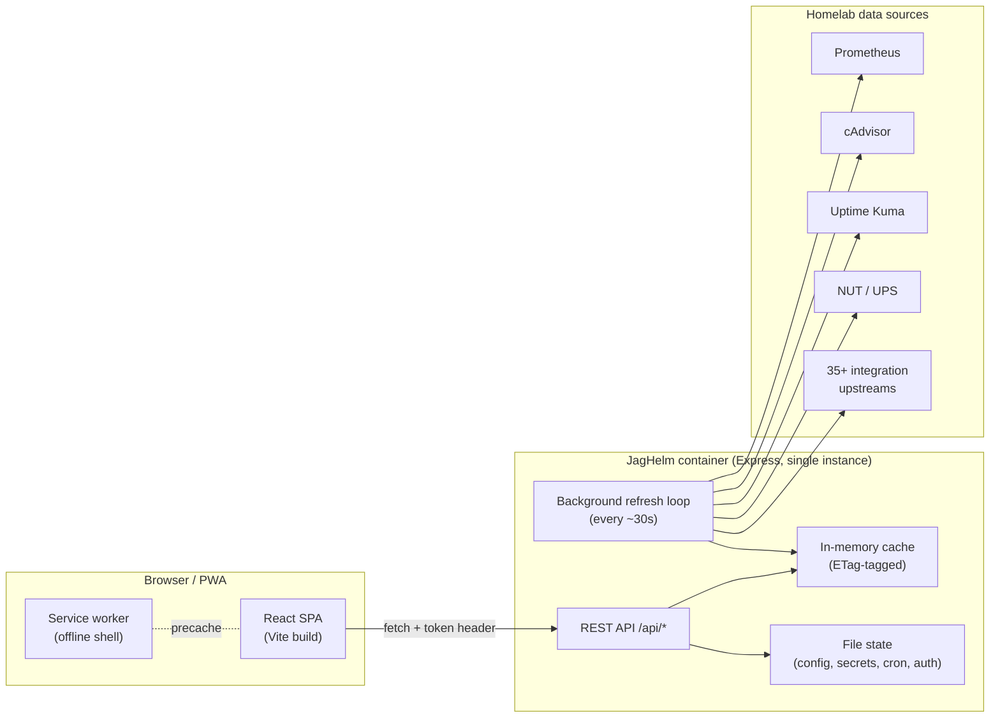
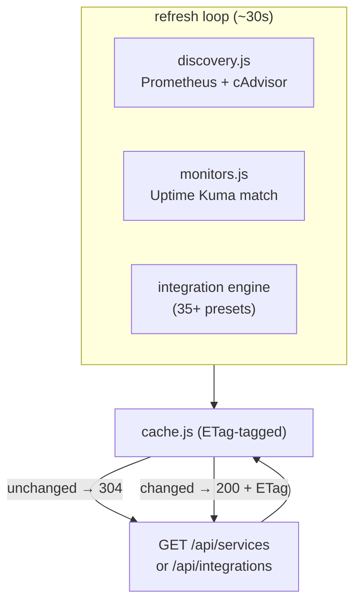
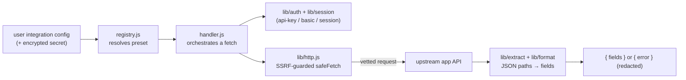
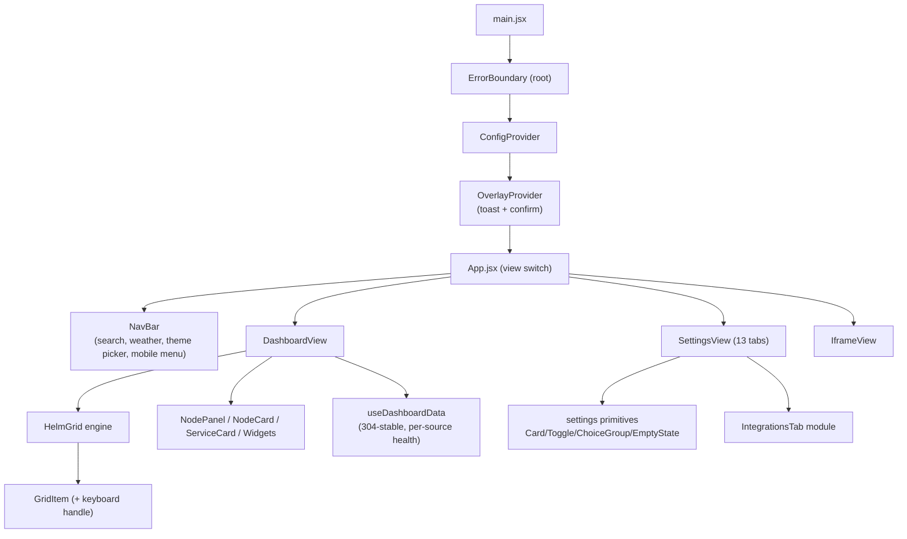
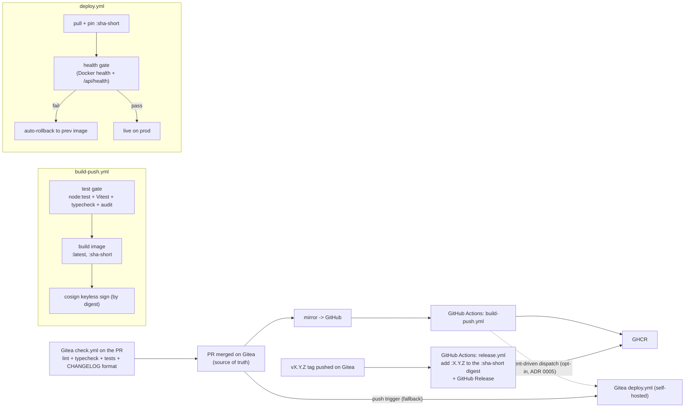

# JagHelm — Architecture

JagHelm is a self-hosted homelab dashboard whose differentiator is **live data,
not just links**: it renders real Prometheus / cAdvisor metrics and pulls live
state from 35+ service integrations, laid out on a custom drag-and-resize grid.
It is **single-user, single-instance, and file-backed** (no database), and ships
as a Docker image to a homelab.

> Reflects `main` as of v1.2.0. For *why* specific decisions were made, see the
> ADRs in [`docs/adr/`](adr/). For limitations and scope, see
> [`KNOWN-ISSUES.md`](../KNOWN-ISSUES.md). For the change history, see
> [`CHANGELOG.md`](../CHANGELOG.md).

## 1. Design philosophy

- **Live data over static links.** The point of difference vs Homepage/Dashy is
  that panels show *current* numbers (CPU, RAM, queue depth, block-rate) fetched
  server-side, not just bookmarks.
- **Single instance, in-memory, file-backed.** Sessions live in a `Map`, the
  refresh loop runs in-process, and all user state is a handful of files under a
  data dir. Simple to run; deliberately not horizontally scalable
  ([ADR 0002](adr/0002-in-memory-single-instance.md)).
- **Server does the talking.** The browser only ever calls JagHelm's own API; the
  server fans out to Prometheus, cAdvisor, Uptime Kuma, a NUT exporter, and the
  integration upstreams. Credentials never reach the client.
- **Safe by construction.** Outbound requests pass a single SSRF-guarded fetch
  chokepoint; secrets are encrypted at rest; writes are atomic; config is
  copy-on-read.

## 2. System topology



The browser talks **only** to `/api/*`. A background loop refreshes upstream data
on an interval into an in-memory cache, so API reads are fast and ETag-enabled
(304s on unchanged data). The deploy chain is separate — see §7.

## 3. Repository layout

```
server/                     Express API (Node 26, ESM)
  index.js                  app wiring: middleware chain + route mounts + SPA fallback
  refresh.js                background refresh loop (start/stop)
  cache.js                  bounded in-memory cache (evicts least recently written, ETags)
  discovery.js              Prometheus/cAdvisor -> nodes + services, one query per reading
                            across all nodes (see 4.2) (ignores containers labelled as Arcane
                            internal helpers, and CI job containers named GITEA-ACTIONS-TASK-…,
                            so short-lived helpers and jobs never become cards or presence
                            breadcrumbs, or take a monitor)
  monitors.js               Uptime Kuma: loads the monitors and assigns them to containers,
                            one container per monitor unless mapped (see 4.2)
  icons.js                  icon picker search index: names only, persisted in the data dir,
                            refreshed from GitHub by the first search when a day old (see 6)
  icon-cache.js             public /api/icons/cached: icon-repository icons on disk, size-capped
                            with LRU eviction (see 6)
  icon-sources.js           the icon repositories it may fetch from; the web client imports it too
  config.js                 services.yaml: load, hot-reload watch, copy-on-read + atomic save
  secrets.js                AES-256-GCM secret store (per-install KDF salt)
  cron-store.js             cron history (bounded)
  errors.js                 apiError + global JSON error handler
  version.js                single source of version (reads package.json)
  metrics.js                prom-client registry + middleware + /metrics handler
  accessLog.js              one JSON log line per request (full path, no query string)
  demo.js                   DEMO_MODE read-only sample dashboard
  auth/                     scrypt passwords, in-memory sessions, login rate limit, middleware
  routes/                   one router per resource (see 4.1)
  arcane/                   Arcane poller: read-only API client, state derivation, push builders,
                            persisted state, dry-run module (see 4.2)
  integrations/             the integration engine (presets + handler + lib, see 4.3)
  util/                     logger, ssrf, redact, rateLimiter, atomicWrite,
                            configSchema (zod), dataDir, asyncHandler, dedupe
  testing/                  test-only helpers: a mock Prometheus that evaluates JagHelm's
                            PromQL over homelab-shaped series, and the pre-#234 node reader

src/                        React 19 SPA (Vite 8)
  main.jsx, App.jsx         providers (Config, Overlay) + ErrorBoundary + view switch
  api/client.js             apiFetch -- explicit auth-injecting fetch wrapper
  context/                  ConfigContext (config + update via setIn), OverlayContext (toast/confirm)
  hooks/useData.js          fetchJson (304-aware), weather, search engines
  utils/setIn.js            immutable structural-sharing deep-set
  components/HelmGrid/       custom grid engine (gridMath, GridItem, HelmGrid)
  components/settings/       shared primitives + 13 settings tabs (+ IntegrationsTab module)
  components/                NodeCard, ServiceCard, Widgets, NavBar, overlays, etc.
  views/DashboardView/       grid + panels + useDashboardData (304-stable) + per-source health
  views/SettingsView.jsx     13-tab settings shell + collapsible live preview
  styles/global.css          today's themes (10) + their tokens + component styles
  styles/fonts.css           today's fonts, self-hosted: the files Google Fonts served (see 5.1)
  styles/legacy.css          imports global.css and fonts.css into the `legacy` cascade layer
  fonts/                     every woff2 the web app ships (latin subsets) and their OFL licences
  ui/                        the redesign's component library, shared with Android (see 5.1):
                             tailwind.css (the stack's stylesheet), tokens.css (the design
                             tokens, docs/design-system.md), accents.js (the accents offered),
                             typefaces.js (the faces offered), fonts.css (their @font-face),
                             preflight.css (generated),
                             shadcn/ui components (button.jsx, a stock placeholder until #285),
                             lib/utils.js

public/sw.js                service worker (precache injected at build)
components.json             shadcn/ui CLI settings (JSX, Base UI, `@ui` -> src/ui/)
scripts/                    inject-sw-precache.mjs, check-assets.mjs, changelog-lint.mjs,
                            changelog-fold.mjs, release-notes.mjs (build/CI/release helpers),
                            ui-preflight.mjs (writes src/ui/preflight.css),
                            ui-contrast.mjs (the design tokens' contrast check)
changes/                    CHANGELOG fragments, one per PR (mobile/changes/ for Android);
                            the release PR folds them into the CHANGELOG (RELEASING.md)
.github/workflows/          build-push.yml (test -> build -> sign -> GHCR), release.yml (tag ->
                            promote by digest -> GitHub Release), build-apk.yml (signed APK)
.gitea/workflows/           check.yml (PR gate), deploy.yml (pin -> health-gate -> rollback)
docs/adr/                   architecture decision records (0001-0005)
```

## 4. Backend architecture

### 4.1 Express server & middleware chain

`server/index.js` wires the app in order: Prometheus metrics middleware -> request
logger -> Helmet security headers + **Content-Security-Policy (report-only)** ->
CORS -> `express.json({ limit: '1mb' })` -> `/uploads` static -> `/metrics` ->
(optional `DEMO_MODE` middleware) -> the API routers -> hashed-asset static
(`immutable, 1y`; a missing file is a 404, never the SPA fallback) -> SPA fallback
(`index.html`) -> the global JSON error handler.
It listens on `JAGHELM_HOST` (default `0.0.0.0`, every IPv4 interface) and `PORT`
(default 3099); if it can't (an address the machine doesn't have, a port in use),
it logs `cannot listen` and exits 1.

Routers (each `server/routes/*.js`), mounted under `/api`:

| Mount | Auth | Purpose |
|-------|------|---------|
| `/api/auth` | public | login, logout, auth-status |
| `/api/health`, `/api/readyz` | public | liveness / readiness probes |
| `/metrics` | public | Prometheus exposition |
| `/api/services` | token | discovered nodes + services (background-refreshed, ETag) |
| `/api/integrations` | token | per-integration live data (background-refreshed, ETag) |
| `/api/display-config` | token | the display config blob |
| `/api/secrets` | token + **auth-required** | encrypted credential store (fail-closed) |
| `/api/cron`, `/api/todos`, `/api/upload`, `/api/icons` | token | widgets + asset upload |
| `/api/icons/cached` | public | icon-repository icons from the local icon cache (an `` can't send the token; see 6) |
| `/api/...` (infrastructure) | token | UPS, Gitea activity, etc., read from the refresh loop |

Auth is a **header token**, not a cookie (so permissive CORS is not a CSRF
vector). `/api/secrets` additionally goes through `requireAuthEnabled` -- it
returns 403 when no password is set, so an open instance can't enumerate
credentials ([KNOWN-ISSUES](../KNOWN-ISSUES.md) covers the open-by-default model).

### 4.2 Background refresh & cache

`refresh.js` runs a single in-process interval that re-fetches node/service
metrics and every configured integration that is due (see 4.3) into the bounded `cache.js`
(it evicts the least recently written key at max entries, so user-influenced
keys can't exhaust memory). API reads serve from the cache and attach an ETag;
an unchanged poll returns `304`.
Each cached value is serialized and hashed once, on its first request, and kept
with it, so later requests (`200` or `304`) only send what is already in memory
until the next refresh replaces the value.
`If-None-Match` is matched per RFC 9110: weak comparison, a list of tags, or `*`.
Two reads served outside the cache have their own reuse rules: `/api/history`
(the sparkline series, which changes every cycle) carries an ETag of its
response, and `/api/cron/status` (whose `seconds_since_report` changes every
second, so an ETag would never match) sends `Cache-Control: private, max-age=60`.
The loop is cancelled cleanly on shutdown (no leaking timer).

Node data comes from Prometheus in one batch per cycle (`getNodesData` in
`discovery.js`, #234): one instant query per reading, each matching every
visible node at once (`node=~"a|b|…"`, labels regex-escaped) and split by the
`node` label in JS. That is 13 queries a cycle (`NODE_QUERIES`) whatever the
number of nodes, plus one for the UPS (its four NUT series in one
`{__name__=~…}` selector); it was 14 per node, 2 more every cycle for a node
with no `/` filesystem, and 4 for the UPS (90 a cycle with the homelab's six
nodes). The queries: `up` (max by node), CPU, memory (MemTotal, MemAvailable
and MemFree in one selector), uptime, temperature, disk (size and free in one
selector), and the containers' last-seen, CPU, memory, RX and TX rates, and RX
and TX counters (the four network ones per interface). What they read:

- **Temperature** is the hottest sensor, `max by (node)` over
  `node_hwmon_temp_celsius` (a node has 0 to 14 such series; the VMs have
  none). On pve at idle that is the r8169 NIC, not the CPU.
- **Container memory** (`docker.memMB`) is `container_memory_working_set_bytes`,
  which leaves out page cache the kernel can reclaim.
- **Container RX/TX** comes `sum by (node, name, interface)`, and `discovery.js`
  sums each container's interfaces, leaving out `VIRTUAL_INTERFACES`: lo,
  veth\*, docker\*, br-\*, virbr\*, VPN tunnels (tailscale\*, wg\*, tun\*,
  tap\*) and VLAN subinterfaces (`eth0.10`), which carry traffic another
  interface already counts. What remains is the container's own eth0, eth1, ….
  `docker.rxBytesPerSec` / `txBytesPerSec` are the 5-minute rate in bytes per
  second; for up to 5 minutes after a container is recreated, the rate also
  counts the replaced container's series and reads high. `docker.rxMB` / `txMB`
  keep their meaning, the cumulative counter in MiB (now summed over those
  interfaces, where it used to be the alphabetically last interface), until the
  old endpoints are removed (overhaul P4-4); their two queries go with them.
- **Host-network containers** have no traffic counters of their own: cAdvisor
  reports the host's interfaces for them, so each would show the host's
  traffic. One is told by an interface outside `OWN_NAMESPACE_INTERFACES`
  (eth\<N\>, and the tunnels tun\*, tap\*, wg\* and tailscale\* a container can
  bring up itself): a physical interface not named eth\<N\> (ens18), a Docker
  bridge (br-\*) or a VLAN (eth0.10). It gets `docker.networkMode: 'host'`
  (null for every other container), and all four RX/TX fields are null, which
  the web card shows as "—". Live on 2026-10-19 that is jaghelm,
  omada-controller and tailscale on vm103 (ens18, ens18.10, tailscale0, 15
  br-\*) and adguard-secondary and tailscale on pi2 (eth0, eth0.10, tailscale0,
  9 br-\*); every other container reports only eth0 to eth2. The limit: on a
  host whose only interfaces are eth\<N\>, with no VLAN and no Docker network
  but the default bridge, a host-network container looks like a bridged one.
- **Disk** is `/`, or for a node without one (the NAS) its largest filesystem.
  Which a node has is decided from the first answer that lists its
  filesystems: after that, the disk query asks a node with `/` for `/` alone and
  lists every filesystem only for the nodes without one (or not decided yet),
  so no node is asked for a `/` it lacks. Decisions are kept per node label,
  so a new node starts undecided and a changed node set needs no
  invalidation; a node whose `/` stops answering is decided again, and
  `initDiscovery` forgets them all.

A failed upstream poll is never read as an empty answer. A Prometheus query
that errors, times out or returns no query result rejects (`promQuery` in
`discovery.js`), and Kuma's `fetchMonitors` returns `ok: false` when it loaded
no monitors. The `/api/services` payload says which answered this cycle,
`sources: { prometheus: { ok }, kuma: { ok } }`, and `/api/ups` carries its own
`ok` (and `configured: null`, since a failed query can't say whether there is a
UPS). Each node also carries `reachable`, from Prometheus' `up` series for that
node: true when any of its targets answered the last scrape, false when none
did, null when no `up` series has the node's label. It carries `failedReads`
too: the parts of the node whose queries failed this cycle (`NODE_READS`:
`reachable` for the `up` query, `cpu`, `mem`, `disk`, `uptime`, `temp`,
`containers`). Each query covers every node, so a failed one is that reading's
failure on every node: the `up` query failing leaves every node's reachability
unread, and a metric query failing that metric. A node missing from an answer
that succeeded has no data for that reading, which is not a failure.
Prometheus counts as failed for the cycle when any node query fails, and also
when every query answers but no node has an `up` series after an earlier answer
had some: a Prometheus that has just started and not scraped yet, whose empty
answers mark every node's reads failed. While Prometheus fails, no presence
breadcrumbs are drawn, since a container missing from the list may still be
running. The push snapshot keeps its last state for what a failed source feeds,
and only that: for a host, only the readings whose queries failed, so a metric
query that keeps failing holds that metric on every host (and, for a host with
no `up` series, its reachability), and a host's `up` at 0 still pages. A missing payload (a cold cache after a restart, or one past its TTL)
counts as failed, and no baseline is taken while the UPS read fails or
Prometheus fails with no host read. So an outage of Prometheus or Kuma sends no alerts about the
hosts and services they watch ([mobile/DESIGN.md](mobile/DESIGN.md),
"Deterministic state-change detection").

#### Kuma monitors and containers

A Kuma monitor is one service, so it marks one container (#240): a down monitor
paints one card red and sends one push, unless `services.yaml` maps it to
several containers. Each cycle `assembleServices` (`refresh.js`) hands
`assignMonitors` (`monitors.js`) every shown, running container (the same name
on two nodes is two containers), plus the containers that stopped in the last
24 hours (the container registry's missing ones, kept for
`JAGHELM_PRESENCE_TTL_MS`, 24 hours by default), and the monitors are assigned
to them all at once. CI job containers take no part: discovery drops them, and
records of them the container registry already holds are skipped too.

1. **Explicit mapping.** A container's entry under `services:` in
   `services.yaml` can name its monitor, as a Kuma monitor's name (compared
   case-insensitively; with two of one name, the lower id), however unlike the
   names are:

   ```yaml
   services:
     immich-server:
       monitor: Immich              # on every node the container runs on
     gateway-npm:
       monitor_per_node:            # keyed by the node keys under `nodes:`
         pi1: NPM Pi Primary
         pi2: NPM Pi Secondary
     vaultwarden:
       monitor_per_node:
         vm103: Vaultwarden         # the pi2 replica gets no monitor
     gateway-tunnel:
       monitor: false               # no monitor, and no name matching
   ```

   `monitor_per_node[<node>]` comes first, then `monitor`; a node with no entry
   in `monitor_per_node` falls back to `monitor`, and to name matching when
   there is none. `false`, in either place, gives the container no monitor and
   keeps it out of name matching and out of the "no matching monitor" log line;
   `null` or an empty name is no mapping. Every monitor named anywhere in these
   mappings goes only to the containers mapped to it, whether or not they are
   on the board this cycle: while they are all absent, nobody has it, and an
   outage is drawn on its last-seen node. When a mapping names a monitor Kuma
   does not have, or a paused one (the `/metrics` source leaves paused monitors
   out), the container gets no monitor and is left out of name matching, so it
   takes nothing another container would have had. (It used to fall back to a
   name match: on 2026-10-19 the four gateway containers on the Pis, mapped to
   monitors Kuma lacks, all took "Pi Gateway (Ping)" that way.) That warns once
   per mapping per boot, and not while Kuma has given no monitors at all; a
   `monitor_per_node` key that is no node, or a value that is neither a name nor
   `false`, warns once too. `POST /api/services/config` refuses a mapping of
   the wrong type (`util/configSchema.js`). The Settings UI edits `monitor`
   only, and keeps `monitor_per_node` when it saves.
2. **By name, one container per monitor.** Every pair of a container and a
   monitor whose names match is ranked, and pairs are taken best first, each
   only while its container and its monitor are both free. Names compare
   lowercased with everything but letters and digits removed. A pair ranks by
   the kind of match: exact; then URL, a monitor named as a URL or hostname
   whose first label is the container name (`grafana.example.com`); then
   contains, one name inside the other (scored by the shorter one's length);
   then a shared word of 4 letters or more (scored by the total length of the
   shared words of 3 or more). Between equally good matches: a container that
   is not a stack's helper (its own words include none of `redis`, `db`,
   `postgres`, `cron`, `runner`, `proxy` and the like, so "Immich" goes to
   `immich-server`); then the board's node order; then the container name;
   then the monitor id. That is a total order, so the result does not depend on
   the order discovery or Kuma listed things in.

   A monitor goes only to a container with the best kind of match any container
   has with it. When that container holds a better monitor, the monitor is left
   unassigned rather than taken by a weaker lookalike: with monitors "Gitea" and
   "Gitea SSH", `gitea` takes "Gitea", and "Gitea SSH" goes to nobody, not to
   `gitea-runner` by the shared word.

Ties between nodes go by the board's node order, so the assignment depends only
on the current cycle's inputs and corrects itself after a container misses a
cycle. No memory of the last node is kept: one that only broke ties drifted to
a replica for good after one missed cycle (vaultwarden runs on vm103 and pi2).
Pin a replica's monitor to its node with `monitor_per_node` instead.

A stopped container competes only for a monitor that is down: that outage then
stays with the container that stopped (a red card under its name, the uid its
running card had) rather than passing to a running lookalike. Once the monitor
is up, or the container has been gone longer than `JAGHELM_PRESENCE_TTL_MS`, it
holds nothing: a running container can have the monitor (`nextcloud` renamed to
`nextcloud-app`), and the stopped one leaves a grey presence breadcrumb like any
container with no monitor. A down monitor no running container got is drawn on
the stopped container's node, else its last-seen node; its card never takes the
uid of a card already on that node (its last container still running there,
matched to nothing or to something else now), and then goes under the
monitor's name.

Such a card, of a monitor no container has ("Pi Gateway (Ping)", "NAS (Ping)"),
exists only while the monitor is down: up, it draws nothing on the board. The
push snapshot still has it (#390). Every active monitor no running container
got, up or down, is placed in one pass by `placeMonitor` (`refresh.js`), so its
uid does not depend on its status while its last container isn't in the
stopped list (#395). A down one is the red card. The uid of an up one goes in
`upWithoutCard`, which the services refresh keeps beside the cached
`/api/services` payload, not in it: it is for push only, so it is not served
and does not change the ETag. `buildServices` (`push/snapshot.js`) reads it as
`up` unless a card on the board has that uid. A grey presence breadcrumb does
not count: placement skips every other card's uid, so only a breadcrumb can
share it, normally the one the monitor's own stopped container leaves while the
monitor is up, and a recovery within `JAGHELM_PRESENCE_TTL_MS` of that
container stopping is sent rather than lost. So the monitor sends
`service_down`, then `service_recovered` on the same id. A paused monitor
(stale heartbeat, or `active: false`) and one Kuma no longer has are in
neither, so they send nothing. The entries come from Kuma, so the source
failure rules above apply to them: while Kuma fails, the whole services map is
held. While Prometheus fails with the container list missing, a monitored
container's monitor is unclaimed too, so up it is an entry under its card's
uid, and a recovery during the outage is sent when Kuma reports it. Only when
no node could be read at all is nothing placed; the recovery then waits for
the container to be seen again.

A monitor feeds one key of the push snapshot a cycle: the card of the running
container that has it, else its own uid. When a container takes it (one appears
whose name matches), its own key leaves the snapshot without an event and the
container's card starts with no previous status. When that container goes, the
service registry remembers it, so the monitor's own uid is the container's from
then on. The snapshot has no monitor identity, so when the key moves while the
monitor is down, the snapshot loses track of the outage. These cases are left
for #395:

- A new container takes a down monitor: `service_down` is sent again, on the
  container's card, for an outage already pushed under the old key.
- A different container takes the monitor in the cycle it recovers (nextcloud
  stops, the monitor goes down, nextcloud-app comes up healthy): the
  container's card starts at `up`, so nothing is sent, including the
  `service_recovered` the key of its down push was waiting for. Taking a
  monitor that was already up sends nothing, which is right.
- Two monitors remember the same container (left by the old matcher). When the
  one earlier in the order drops out (a Kuma Pending retry, a pause, a
  container claiming it), the other, if down, moves onto the container's uid
  and sends a second `service_down` there. When the first comes back, the
  other moves back: a false `service_recovered` on the container's uid, and
  another `service_down` under its own name. No such pair exists live.

The service registry's `seen` list has one record per monitor, the last node in
the pass for one mapped explicitly to a container on several nodes. A record is
written only when a monitor's node or container changes, so cycles that match
the same way write nothing, whatever order discovery returns containers in.



`server/arcane/` adds a second, independent loop when `ARCANE_URL` and `ARCANE_API_KEY` are
set (never in demo mode): `startArcane()` runs from `boot()` and polls the Arcane manager
every `ARCANE_POLL_SECONDS` (default 300) plus a release check every
`ARCANE_RELEASE_CHECK_HOURS` (default 6). With FCM credentials configured, the first poll and
release check wait up to 30 s for push to be ready. It diffs against persisted state and emits
push events through `dispatchEvents`, and records Arcane's scheduler-started update and prune
runs, and its image watcher's checks, into the cron store. On its own weekly timer it also
reads Arcane's stored vulnerability scan results for the environments in
`ARCANE_VULN_DIGEST_ENVS` and pushes a digest per environment when something is new
(`arcane_vulns`), recording each digest as the `arcane-vuln-digest` cron job. Its `arcane_*` push types map to the `watchtower` preference category (labelled Updates
in the app). Setup: [arcane/SETUP.md](arcane/SETUP.md).

### 4.3 Integration engine

The differentiator. A declarative **preset** (`integrations/presets/*.js`, one
file per app) describes how to talk to one app: endpoints, auth mode, and which
JSON paths map to which display fields. The registry loads every `.js` file in
`presets/` except `*.test.js`, so helpers the presets share live in `lib/`
(e.g. `lib/createArrPreset.js`). A preset flagged `unsupported` still loads, so
an existing config that names it resolves, but `listPresets()` leaves it out of
the gallery and it can't be added; the docs count only the 35+ a user can add.
The flow:



Key properties:

- **One guarded chokepoint.** Every outbound request goes through
  `lib/http.js` `safeFetch`, which calls `assertSafeUrl` (`util/ssrf.js`) by
  construction -- blocking cloud-metadata IPs, decimal/hex/octal IPv4, and
  IPv4-mapped IPv6, with a `trusted` flag exempting operator infra (Prometheus/
  Kuma) from the strict private-network block.
- **Credential headers stay on their origin.** Redirects are followed in code
  (`util/safeFetchCore.js`), and a hop to a different origin (scheme, host or
  port) forwards only `Accept`, `Accept-Encoding`, `Content-Type` and
  `User-Agent`. Every other header, so every preset's auth header, is dropped
  and stays dropped for the rest of the chain. The one exception is an
  `http://` to `https://` upgrade on the same host and port (a reverse proxy's
  force-SSL), which keeps them because they were just sent to that host. Both
  cases are logged once per origin pair, with header names and no values.
- **Credentials in the URL stay on their origin too.** A key in the query
  string (SABnzbd, Tautulli, Emby) or a credential filled into a custom
  endpoint's `{token}`, `{password}` or `{username}` can't be stripped from a
  redirect, so the code that builds such a URL (`applyQueryAuth` in
  `handler.js`, `resolveEndpoint` in `lib/extract.js`) passes
  `credentialInUrl`, and the request refuses any redirect to another origin
  with an error telling the user to configure the final URL. The same-host
  `http://` to `https://` upgrade is still followed, and logged once per
  origin pair like a header-carrying one, since the key went out in clear
  text first. `httpClient.js` `safeFetch` accepts the same option.
- **Request bodies stay on their origin.** A `307` or `308` keeps the method
  and body, so a session login is re-sent, but only to the same origin or
  through the same-host upgrade; a request with a body redirected to another
  origin is refused, so a username and password never reach a host the user
  didn't configure. Refusals, and an upgrade that re-sends a body, are logged
  once per origin pair without values. A streamed body can't be re-sent and is
  refused too. A
  `303`, and a `301`/`302` on any method but `GET`/`HEAD`, becomes a `GET`
  without a body.
- **Credentials are redacted** (`util/redact.js`) before any error is logged *or*
  returned to the browser -- query-auth presets put the key in the URL, which
  fetch errors would otherwise echo.
- **Only the computed result is kept.** A poll returns what the preset
  computes (its fields, plus structured data such as Proxmox's VMs, storage
  pools and last backup), and drops the upstream response once the preset has
  read it. No route returns an integration's upstream response.
- **Session-auth presets** (Nginx Proxy Manager, Portainer, PhotoPrism) get a
  managed login session via `lib/session.js`; the same SSRF guard still applies.
- **A failing integration backs off; a login refused twice waits for a
  config change** (`integrations/backoff.js`, #239). The refresh loop fetches
  only the integrations that are due, through at most 6 at a time. After a
  failure the next attempt waits 30 s, then 1, 2, 4 and 8 min, then 10 min
  each time; a success resets it. Whether an attempt is due is worked out on a
  monotonic clock (`performance.now()`), so a wall-clock step doesn't move it.
  A refused login (`authRejected` from `fetchIntegration`) is a 401 or 403
  from the request's own origin to the session login (to every one of them
  with an `authFallback`) or to a data request that carried the integration's
  credentials (basic, bearer, header or query). A 401 or 403 to a request
  without credentials, one from another origin after a redirect (which
  dropped the credentials, see above), a data read after a good session login,
  and every other failure back off instead.
  - **Two refusals in a row park it.** A first refused login backs off like
    any failure, so a proxy, a WAF challenge or an app answering 403 while it
    rate-limits recovers on the next attempt. A second refusal in a row, under
    the same config, parks the integration in `auth_failed`: it is not
    attempted again until its config changes. Any other outcome in between
    starts the count again. A wrong password so costs two attempts per config,
    well under the five failed logins that qBittorrent and fail2ban allow by
    default before they ban.
  - **What counts as a config change.** Its config is a fingerprint
    (`configFingerprint` in `lib/config.js`, a SHA-256) of its entry in
    `services.yaml` with its URL and credentials resolved, so a hand edit
    picked up by the config watcher, a save in Settings, and a new value for
    the same `$secret:` each count. Each integration is resolved once a cycle
    and the fetch reuses that config. A save in Settings retries it at the next
    refresh even when nothing changed (`retryIntegrationNow`), and a save made
    while its fetch is in flight holds for the refresh after that. The state
    is in memory, so a restart attempts every integration. Removing an
    integration, or disabling it, drops its state only when a refresh runs
    without it: a hand edit that removes and re-adds it, or disables and
    re-enables it, between two refreshes leaves it parked, since its config
    is the same.
  - **How it is served.** An integration that is not due is not queued, so it
    holds no fetch slot and spends no timeout: its entry is the one its last
    attempt left, served again, `_error` included, as the failure was served
    when it happened (no last good data). A parked integration's `_error` ends
    with a fixed hint: "(login refused twice; not retried until it is saved in
    Settings)" for an entry exactly as a save in Settings writes it
    (`savedFromSettings` in `lib/config.js`), and "(... not retried until
    services.yaml changes or JagHelm restarts)" for one written by hand,
    which a save in Settings would rebuild and lose parts of (#402).
  - **`_status`.** Every entry in `/api/integrations` carries
    `_status: { state, since, failures, nextAttemptAt }`, with `state` one of
    `ok`, `backing_off` and `auth_failed`, `since` when that state began,
    `failures` the failed attempts in a row under the current config, and
    `nextAttemptAt` the next attempt (null when ok, as it is fetched every
    cycle, or auth failed, as it waits for a config change). Both times are
    wall-clock ms since the epoch, set once per attempt, so none of the values
    change between attempts and the payload's ETag holds. The payload lists
    the integrations in config order. The web app does not read `_status` yet
    (#290 builds the status model on it). It shows `_error` as the note on
    the service card the integration is matched to, so the hint is on screen.

### 4.4 Config, secrets, and persistence

- **Display config** (`config.js`) is **copy-on-read** (`getConfig()` returns a
  `structuredClone`) and saved via a synchronous **atomic** write
  (temp -> fsync -> rename), so a route can't mutate shared state and a crash
  can't truncate the file ([ADR 0001](adr/0001-atomic-file-writes.md),
  [ADR 0004](adr/0004-config-copy-on-read.md)). It is validated against a Zod
  schema (`util/configSchema.js`) on read, so a malformed file fails loudly.
- **Secrets** (`secrets.js`) are AES-256-GCM encrypted with a **per-install
  random KDF salt** (`data/.secrets-salt`, legacy-static-salt fallback). All
  credential stores write `0600`.
- **Data dir** is single-sourced via `util/dataDir.js` (`JAGHELM_DATA_DIR`) so
  secrets/auth/config/cron and the icon cache never split across locations.

### 4.5 Auth & rate limiting

scrypt password hashing (`auth/passwords.js`), in-memory sessions
(`auth/sessions.js`), and a brute-force **login rate limiter** (`auth/rateLimit.js`).
A reusable `util/rateLimiter.js` additionally throttles the abuse-prone
integration connection-test endpoint.

### 4.6 Observability

- **Structured logging** (`util/logger.js`) with redaction -- no secrets in logs.
  `LOG_LEVEL` (`debug|info|warn|error|silent`, default `info`) filters it.
  Success lines every refresh cycle would repeat are debug, while a refresh
  that keeps failing still logs its own error each cycle. At info: a cycle that
  took 5 s or more; a change in the cycle's set of failed refreshes (a refresh
  that returned null, or an integration with an `_error`, which a backed-off
  one keeps until it answers); a Kuma load whose
  monitor count or source changed; and one line per boot for containers no
  monitor went to. A `services.yaml` mapping to a monitor Kuma does not have
  (or a paused one), a `monitor_per_node` key that is no node, and a mapping of
  the wrong type each warn once per boot. Prometheus failing (any node query of the cycle, or an
  answer with no `up` series after one with some) and Kuma failing (no
  monitors loaded: unreachable, non-2xx, or a status page with none) each warn
  once, with the error, and their recovery logs once at info with how long it
  was down; the failed cycles in between log at debug
  (`util/sourceHealthLog.js`). A failed integration attempt logs its error;
  one parked by a second refused login in a row also warns that it waits for
  a config change, and the first success after failures logs at info
  (`integrations/backoff.js`).
- **Access log** (`accessLog.js`): one line per request with its full path and no
  query string or fragment; 5xx at `error`, 4xx and requests of 300 ms or more at
  `info`, the rest at `debug`. `/metrics`, `/api/health` and `/api/readyz` are not
  logged unless they fail (5xx).
- **Prometheus metrics** at `/metrics` via `prom-client` (`metrics.js`): request
  rate, latency histograms, refresh-loop health.
- **Two probes**: `/api/health` (liveness; reflects refresh-loop liveness -- 503
  when wedged) and `/api/readyz` (readiness; distinguishes "not ready yet" from
  "down"), backing the Docker `HEALTHCHECK` and the deploy gate.

## 5. Frontend architecture



- **State.** `ConfigContext` exposes `config`, the stable `setConfig`, and a
  memoised `update(path, value)` built on `setIn` (immutable structural-sharing
  deep-set) -- so leaf cards memoise and don't re-render on unrelated edits.
  `OverlayContext` provides `useToast` / `useConfirm` (focus-trapped, Escape,
  focus-restore, reduced-motion). `api/client.js` `apiFetch` injects the auth
  token explicitly (replacing an old `window.fetch` monkey-patch).
- **HelmGrid** is a custom, dependency-light layout engine: pure math in
  `gridMath.js` (snap, overlap-resolve, content-fit), per-item measurement +
  rendering in `GridItem.jsx`, and lifecycle (breakpoints, drag/resize, commit)
  in `HelmGrid.jsx`. Panels auto-grow to fit content; pointer **and keyboard**
  (arrow move / Shift+arrow resize, with a live region) reposition them.
- **Panels and first run.** The board has a panel per discovered node and custom
  group, plus the Checklist, Scheduled Jobs and Quick Launch panels. Without a
  saved layout it starts from `DEFAULT_LAYOUTS` (`layouts.js`), which names no
  node, so a fresh install with no node shows the "Connect your first node"
  empty state. The UPS and Pipeline panels show only when the server says their
  source is set up (`configuredPanels.js`). `/api/ups` carries `configured`:
  true when Prometheus has the UPS's readings or saw its `nut_ups_info` series
  in the last 7 days (one query, with `last_over_time`), false when neither,
  null when the query failed. `/api/gitea/activity` answers
  `{ configured: false }` when `GITEA_URL` is not set, and then polls nothing;
  its 502 means a set-up Gitea failed. True shows the panel, with its down state
  when its source is down. False hides it, even when the saved layout names it,
  and drops it from the layout. Null (no answer yet, or a failure that says
  nothing) keeps the last answer this session, and hides the panel before
  there is one. Settings → Sections can hide either panel, not force it on.
  The page-level live region leaves out the outages of sources whose panel is
  hidden.
- **Data fetching.** `useDashboardData` holds a **304-stable identity contract**:
  on an unchanged poll `fetchJson` returns the same reference and `setState`
  bails via `Object.is`, so an all-304 tick triggers zero re-renders. It stores
  a response's ETag and body together, only once the body has parsed, so the
  `If-None-Match` it sends always describes the body a 304 hands back; a 200
  with an empty, malformed or cut-off body fails and keeps the last good pair.
  Per-source health (error / stale / retry) is derived at render without
  per-tick state.
- **Polling.** `App.jsx` drives one tick per refresh interval (30 s by default),
  and only while the dashboard is on screen: a hidden browser tab, Settings or an
  iframe tab pauses it, and returning refreshes every source at once. The board
  loads every source once on mount; a tick then fetches the live sources
  (`/api/services`, `/api/ups`, `/api/integrations`) plus one slow source in turn
  (`/api/history`, `/api/cron/status`, `/api/gitea/activity`), so four requests
  per tick. A panel shows its "updated ... ago" stale note after 2 missed polls
  of its own source (`pollPeriodMs` in `useDashboardData`): 1 minute for a live
  source and 3 minutes for a slow one at 30 s. The navbar health dot reads
  `overallHealth` from the board's own `/api/services` result, so it holds its
  last value while polling is paused (the "Updated" clock keeps counting) and
  catches up on return. The navbar refetches weather at most every 10 minutes.
  The Settings preview loads once when shown and refreshes only on its button.
- **Design system.** 10 themes (`themes.js` + `[data-theme]` token blocks),
  generic `--space-*` / `--text-*` scales plus semantic `--fs-*` card tokens,
  and a global `:focus-visible` ring + reduced-motion handling.
- **PWA.** `public/sw.js` precaches the app shell **and** the hashed first-paint
  bundles (the precache list, the build's full `dist/assets` list + version are
  injected at build by `scripts/inject-sw-precache.mjs`); immutable `/assets/`
  are served cache-first, and other same-origin GETs outside `/api/`
  network-first with a cached copy for offline. Both runtime paths store into
  the same versioned cache; an `/assets/` response is stored only when it is ok
  and not HTML. On activate the worker deletes every other cache and trims
  `/assets/` entries not in the current build's asset list, so a redeploy at the
  same version doesn't leave its old bundles behind. The current build's lazy
  chunks, the shell, `/uploads/` and public files stay cached for offline use.
- **Old tab after a deploy.** A tab still on an older build that opens Settings
  or an iframe tab asks for a chunk the deploy removed, and gets a 404.
  `src/chunkReload.js`, installed by `main.jsx`, listens for Vite's
  `vite:preloadError` (fired for every failed lazy import in a build), cancels
  it and reloads the page once, onto the new build, which reopens the tab that
  was open. The guard is the build: `main.jsx` passes the entry chunk's URL,
  whose hash changes whenever any lazy chunk's name does, and the reload stores
  it in sessionStorage. A chunk failure on a build that already reloaded once
  goes through to the root `ErrorBoundary`'s error screen, whenever it happens,
  so a chunk broken in the current build can't loop. Each later deploy is a new
  build and gets its own reload. Blocked sessionStorage means no reload. While
  the reload is under way, `ErrorBoundary` renders nothing, because the
  cancelled import resolves empty and the lazy view throws. If `reload()` throws,
  the error shows at once; if the page is still there 10 s after asking (the
  navigation was cancelled), the error screen shows then.
  - **The open tab.** Just before reloading, `chunkReload.js` stores the open
    tab's id under a sessionStorage key only it writes. `AppMain` takes it once
    at boot and opens that tab, or the dashboard when the config no longer has
    it. An ordinary reload still opens the dashboard.
  - **Also covered, one reload then the error screen.** The same event fires
    for a chunk that is served but throws while it evaluates, and for a fetch
    that fails because the browser is offline. Each gets the one reload. A chunk
    that throws on the new build too shows the error screen straight after it.
    Offline, the service worker answers the reload with the cached shell of the
    same build, so the retry fails on a build that already reloaded and the
    error screen shows, with its Reload button for when the network is back.
  - **Android.** The Android app doesn't need this: its only lazy chunks are
    Capacitor's browser fallbacks for its plugins, bundled in the APK, which
    can't change while the app runs.

### 5.1 UI stack (Tailwind CSS v4, shadcn/ui, Lucide)

The overhaul (spec `docs/superpowers/specs/2026-10-18-jaghelm-overhaul-design.md`,
§5) rebuilds the screens on one component library in `src/ui/`, used by the web
app and, from Phase 4, the Android app. Until the last old screen goes, the new
stack sits beside today's CSS and must not restyle it.

- **Toolchain.** Tailwind CSS v4 compiles at build time through `@tailwindcss/vite`
  in `vite.config.js` and `mobile/vite.config.mobile.js`, into each app's one
  hashed stylesheet. Nothing is injected at runtime or loaded from a CDN.
  shadcn/ui is set up in `components.json`: JSX (no
  TypeScript), the Base UI primitives (style `base-nova`), and the `@ui` alias for
  `src/ui/` (`tsconfig.json` `paths`, so `npx shadcn add <name>` writes
  `src/ui/<name>.jsx`). Components import `cn` from the `cn` package, as the shadcn
  registry now generates them. Icons come from `lucide-react` by name
  (`import { Check } from 'lucide-react'`), so a bundle carries only the icons it
  uses. `src/ui/button.jsx` is the only component so far and no screen uses it.
- **Both apps import `@ui/...`.** The Android build maps `@ui` to `../src/ui` and
  lists React and every package `src/ui/` imports in `resolve.dedupe`, so shared
  code uses the Android app's own copies: the APK build installs `mobile/` only,
  and a second React breaks hooks. A package added to `src/ui/` goes in both
  `package.json` files and that list; `scripts/ui-stack.test.mjs` checks it.
- **Cascade layers.** The order is `legacy, properties, theme, base, components,
  utilities`, declared at the top of every entry stylesheet. Each app's
  `styles/legacy.css` imports today's stylesheets into `legacy`, the lowest layer
  (web: `global.css` and `fonts.css`; Android: `MobileApp.css`, `Login.css`, `global.css` and
  `fonts.css`, in the order the bundle had them). The new stack's rules therefore
  win wherever both style an element: without this, `global.css`'s unlayered
  `* { margin: 0; padding: 0 }` would beat every spacing utility. Components do not
  import stylesheets themselves, since an unlayered sheet would outrank both.
- **Preflight is scoped.** Tailwind's reset would restyle every element on the
  page (margins, lists, headings, `svg` display). `src/ui/preflight.css` is
  Tailwind's preflight wrapped in `@scope (.jh-ui)`, generated by
  `node scripts/ui-preflight.mjs`; rerun it after a Tailwind upgrade (a test fails
  until you do). Give `jh-ui` to the root of each new screen and to portalled
  content (dialogs, popovers, menus render outside their parent). `@scope` needs
  Chrome or Edge 118, Safari 17.4 or Firefox 146; the Android WebView is current
  Chromium. In an older browser new components lose the reset, and today's
  screens are unaffected either way.
- **Only `src/ui/` is scanned** for class names (`source(none)` plus `@source`,
  tests excluded), and every class found there ships whether a screen uses it or
  not. Add an `@source` line for each new folder of screens. Utilities are global
  classes in a layer above `legacy`, so a legacy class name that is also a utility
  (under this theme, not just Tailwind's defaults) would be restyled on today's
  screens as soon as any file in `src/ui/` mentions it, even in a comment.
  `scripts/ui-stack.test.mjs` compiles every legacy class name (selectors in the
  legacy stylesheets, `className` strings outside `src/ui/`) and fails on any
  utility except `flex-1` and `sr-only`. That is why `.text-muted` and
  `.text-secondary` became `.muted-text` and `.secondary-text`: shadcn's `muted`
  and `secondary` roles make `text-muted` and `text-secondary` colour utilities.
  When the test fires, rename the legacy class or pick another role name. Of the
  two shared names, `flex-1` sets the same `flex: 1`. Legacy `.sr-only` sets
  `position: absolute !important`, which also beats a new component's
  `not-sr-only` (for `!important` the lowest layer wins): drop that `!important`
  when a component first needs `not-sr-only`.
- **Tokens.** JagHelm's design tokens are in `src/ui/tokens.css`, from the
  signed-off mock: a palette of OKLCH ramps, the roles components use, and a few
  component tokens, in dark and light, with three accents (Violet, Fuchsia,
  Cyan; `src/ui/accents.js` is the one list), two densities and three
  typefaces (`src/ui/typefaces.js`) switched by `data-theme`, `data-accent`,
  `data-density` and `data-typeface` on the `.jh-ui` root. [design-system.md](design-system.md) lists them with the rules for using
  them, and `scripts/ui-contrast.mjs` checks every text/background pairing in
  every theme and accent against the spec's floors, as sRGB and Display P3
  screens paint them, that each accent's hover is visibly different from
  its rest state, and that no accent colour sits within ΔE OK 0.05 of a status
  colour (`ui-contrast.test.mjs`).
  They are custom properties on `.jh-ui`, prefixed `--jh-`, never on `:root`:
  today's CSS owns `--bg`, `--accent`, `--border`, `--card`, `--muted`,
  `--text-*`, `--font-mono`, `--font-body` and `--font-display` there and in the
  Android shell, and the prefix keeps an old widget inside a new screen on its
  own values. `tailwind.css` offers the roles as utilities (`bg-surface-1`,
  `text-text-2`, `text-crit-fg`), plus shadcn's role names mapped onto them so a
  generated component compiles, and clears Tailwind's default palette, type
  sizes, font families, radii, shadows, text shadows and blurs
  (`ui-tokens.test.mjs`, which also fails on gradient text and on shadcn's
  `accent-foreground`). The theme is inline
  and reference-only (`theme(inline reference)`, `@theme inline reference`):
  utilities carry their values, and Tailwind writes no variable to `:root`,
  where anything it wrote would land in the `theme` layer, above `legacy`. The
  `dark` variant applies inside a `.jh-ui` root without `data-theme="light"`.
  Every variable a class reads with `var()` must be declared under `.jh-ui`: a
  role reads its token (`bg-surface-1` reads `--jh-surface-1`), and a class that
  reads a variable itself (the Button's `rounded-[min(var(--radius-md),10px)]`)
  needs that variable there too, which is why the radius scale is in both
  `tokens.css` and `tailwind.css`. Never add a `:root`, `html` or `body` rule or
  a `@theme` block without `reference`. `scripts/ui-stack.test.mjs` compiles the
  stack and fails on an unlayered rule, a root selector, a base rule outside
  `@scope (.jh-ui)`, a `var()` read that `.jh-ui` doesn't declare, the two
  radius scales drifting apart, or a class in `src/ui/` that compiles to nothing
  (with Tailwind's sizes cleared, `text-sm` would silently do so).
- **Fonts are self-hosted** (#244, #284): no font or stylesheet comes from
  another origin, and the server CSP allows fonts and styles from `'self'` only
  (`server/index.test.js`). Every woff2 lives in `src/fonts/` with its OFL
  licence, and Vite emits each as a hashed asset. Today's screens use
  `src/styles/fonts.css`: the exact latin files Google Fonts served the default
  Typography preset (Outfit, DM Sans, JetBrains Mono) and the Clean, Rounded and
  Sharp presets, with Google's descriptors, so they render pixel for pixel as
  before; `useThemeVars` no longer injects a Google stylesheet when a preset is
  picked. The new UI's faces are in `src/ui/fonts.css` (Manrope by default, Plus
  Jakarta Sans or Montserrat by `data-typeface`, JetBrains Mono), under family
  names ending in "Variable" so they never join today's families; JetBrains
  Mono's file is shared, so it downloads once. A browser downloads a face only
  when text renders in it, and nothing is preloaded. `scripts/fonts.test.mjs`
  checks that every `@font-face` matches its file and licence, that nothing
  names Google Fonts or loads a font or stylesheet from elsewhere, and the new
  UI's 60 KB budget; [design-system.md](design-system.md#type) has the faces and
  the scale. The Android app keeps its own copies (`mobile/src/fonts/`) for
  today's screens.
- **When the old CSS is gone,** drop the `legacy` layer and the scoping: import
  Tailwind's own preflight, move the tokens to `:root` and drop `reference`.
  Delete `src/styles/fonts.css` and every file in `src/fonts/` but the new UI's
  four faces.

## 6. Data model

All state is files under the data dir (no DB):

- **services.yaml** -- nodes, per-service overrides (display name, icon, and
  the Kuma monitor mapping `monitor` / `monitor_per_node`, see 4.2) and
  integration configs (each secret value stored separately, encrypted). Hot-reloaded on an
  external edit; read copy-on-read; `POST /api/services/config` validated by Zod.
- **display config** -- title, theme, layout (`{lg,md,sm}` grid item arrays),
  sections (per-panel visibility/order/colour), nav/search/weather flags,
  links, tabs, fonts. Read copy-on-read; validated by Zod.
- **secrets** -- AES-256-GCM blob, keyed by integration storage key.
- **Arcane state** -- `arcane-state.json` (baselined environments, agent down counters,
  seen activity ids, each environment's pending updates, runs waiting on their job run,
  last notified release),
  `arcane-held-back.json` (held-back containers per environment) and
  `arcane-vuln-state.json` (each environment's critical/high finding keys, KEV count and
  stale or failed images at the last vulnerability digest, and when it last ran); atomic writes, tolerant load.
- **cron history**, **todos**, **auth** (password hash + salt) -- small files,
  atomic writes.
- **icon index** -- `icon-index.json`: the SVG names of the two icon repositories
  (homarr-labs/dashboard-icons, selfhst/icons) with each listing's ETag and when
  it was last checked; about 170 KB, atomic writes, tolerant load. A cache, so
  deleting it is safe. Boot only reads it and never calls GitHub; the first icon
  search after it is missing or a day old lists each repository's `svg/`
  directory on its default branch (conditional on the ETag, 8 MB body cap). A
  failed or truncated refresh keeps the index it has and is retried after an
  hour, or after 5 minutes while there is no index to serve.
- **icon cache** -- `icon-cache/`: each icon `/api/icons/cached` has served, one
  file named by the SHA-256 of its canonical URL. The route is public, so it
  fetches only icons of the two icon repositories (Dashboard Icons, selfh.st) as
  SVG, PNG or WebP at a moving ref, on jsDelivr or raw.githubusercontent.com
  (`icon-sources.js`); it rebuilds the URL from that allowlist, so a query string
  or another spelling of one icon is the same file, and follows a redirect only to
  another such URL. An icon must be the image type its extension names and at
  most 512 KB; a larger one is not cached and the browser is redirected to the
  CDN for it. The whole cache is capped at `JAGHELM_ICON_CACHE_MAX_MB` (50 MB)
  and drops the least recently used icon to stay under it; the files on disk
  are counted at boot, oldest written first, and the count is kept in memory.
  At most 8 fetches from the CDN run at once (a browser opens 6 connections to an
  HTTP/1.1 origin, so one page load never waits) and 256 more wait; past that a
  miss is a 503 with `Retry-After`. Concurrent requests for one icon share one
  fetch. A body is held only until it is written; every response, a miss's
  too, streams from the file, and one that wasn't stored is a 302 to the CDN,
  so icon bodies in memory stay under 4 MB.
  Served with `Content-Security-Policy: default-src 'none'; style-src
  'unsafe-inline'; sandbox` and `nosniff`. The web client sends only these URLs
  through it and loads any other icon URL directly. A cache, so deleting it is
  safe; icons are fetched again as they are shown.

## 7. CI/CD pipeline



- **PR gate** ([check.yml](../.gitea/workflows/check.yml)) runs on the
  self-hosted Gitea runner for every PR to `main`: secret scan, CHANGELOG
  format (both CHANGELOGs and their `changes/` fragments), lint, typecheck,
  server, web and mobile tests, and the asset check.
- **Build** ([build-push.yml](../.github/workflows/build-push.yml)) runs on
  GitHub for every push to `main`: a test gate (so a red `main` can't ship),
  then build and push `:latest` and the immutable `:sha-<short>` with OCI
  labels, then **keyless cosign signing**.
- **Server release** ([release.yml](../.github/workflows/release.yml)) runs on
  GitHub when a `vX.Y.Z` tag arrives from Gitea. It does not rebuild: it checks
  the tag (on `main`, matching `package.json` and a CHANGELOG section), waits for
  that commit's `:sha-<short>`, verifies its signature, adds `:X.Y.Z` to the same
  digest, and creates the GitHub Release from the CHANGELOG. Published image tags
  never move and release pages are never rewritten. Procedure:
  [RELEASING.md](RELEASING.md).
- **Android release** ([build-apk.yml](../.github/workflows/build-apk.yml)) runs
  on GitHub for a `mobile-vX.Y.Z` tag: it builds and signs the APK, then a
  release job attaches it to a GitHub Release with notes from
  `mobile/CHANGELOG.md`. A manual run is a
  test build and creates no release.
- **Deploy** ([deploy.yml](../.gitea/workflows/deploy.yml)) runs on the
  self-hosted Gitea runner labelled `vm103` (no other workflow may use that
  label): pull and **pin this commit's `:sha-<short>`** image,
  recreate behind a **health gate** that auto-rolls-back to the previous image on
  failure.
- **Event-driven trigger** ([ADR 0005](adr/0005-event-driven-deploy.md)): the
  build dispatches the deploy when the image is ready, replacing a GHCR poll. It
  is opt-in and fallback-preserving -- the push trigger remains until verified.

## 8. Testing

Automated tests gate every PR to `main` (`check.yml`) and every build of `main`
(`build-push.yml`):

- **Backend** (`node --test`, `npm run test:ci`): the AES-GCM secrets round-trip +
  tamper, the SSRF guard vectors, credential redaction, the upload allowlist,
  config schema/copy-on-read (incl. a `SIGKILL`-mid-write chaos test), route
  contracts, rate limiting, `/health` + `/readyz`, and the pure HelmGrid
  `gridMath`, the service-worker precache injector, and the worker's install,
  activate and fetch handlers run against a fake cache (`scripts/sw.test.mjs`).
  Node reads run against a mock Prometheus (`server/testing/mockPrometheus.js`)
  that evaluates the PromQL JagHelm sends over series shaped like the homelab's
  and counts the queries: the per-cycle budget, and the batched reads against
  the per-node reader they replaced (`server/testing/legacyNodeData.js`).
- **Client** (`npm run test:client`, Vitest + jsdom + React Testing Library):
  NavBar/config-driven rendering, settings primitives, the keyboard grid handle,
  per-source health banners, overlay/confirm semantics, the 304-stable data
  hook, the old-tab chunk reload, its per-build guard and stall watchdog
  (`src/chunkReload.test.jsx`) and the tab it reopens (`src/App.reloadTab.test.jsx`),
  and the `src/ui/` components.
- **Mobile** (`npm run test:mobile`, Vitest): the Android app's views, login,
  push routing, on-device storage, and the shared `src/ui/` components through
  the Android build's `@ui` alias.
- **Repo guards** (`node --test`, `scripts/*.test.mjs`): the deploy runner pin,
  the secret floor (`.gitignore`, tracked templates, the scanner catching a
  planted key) and its wiring in `check.yml`, the docs' preset and test
  counts (`doc-counts.test.mjs`), and the UI stack's separation from today's
  CSS and its reach into the Android build (`ui-stack.test.mjs`,
  `ui-preflight.test.mjs`), and the design tokens' shape and contrast
  (`ui-tokens.test.mjs`, `ui-contrast.test.mjs`), and the fonts and type scale
  (`fonts.test.mjs`). Write new repo checks this way, not as shell
  scripts: `npm test` only collects `*.test.{js,mjs,cjs}`.

`npm test` preloads `scripts/test-data-dir.mjs`, which gives every test process
its own temp `JAGHELM_DATA_DIR`, so the suite never reads or writes the
checkout's `data/` (`scripts/test-data-dir.test.mjs` guards the wiring).

It also preloads `scripts/test-exit-guard.mjs`. From Node 26, `--test-timeout`
bounds each test but no longer a test file's process, so a file that leaves a
server, interval or socket open would keep `npm test` running forever. The
guard fails such a file once it is still running `--test-timeout` ms after its
last test, its after hooks included (`scripts/test-exit-guard.test.mjs`). It
only bounds files that register a test: one that hangs before registering any
still hangs.

The Vitest configs (`vite.config.js`, `mobile/vite.config.mobile.js`) start
their workers with `--no-experimental-webstorage`: Node 25 and later ship a
`localStorage` global of their own, which hides jsdom's.

`npm run test:ci` also fails a run that passes fewer backend tests than the
floor in `scripts/test-floor.mjs`, so a silently dropped test is caught. The
docs give no exact test or preset count, since one goes stale with the next
change; `doc-counts.test.mjs` fails on one.

## 9. Key decisions (ADRs)

| ADR | Decision |
|-----|----------|
| [0001](adr/0001-atomic-file-writes.md) | Atomic temp->fsync->rename writes for all user state |
| [0002](adr/0002-in-memory-single-instance.md) | Single-instance, in-memory state (no DB) |
| [0003](adr/0003-scoped-tls-bypass.md) | Per-request, opt-in TLS-verify bypass for self-signed infra |
| [0004](adr/0004-config-copy-on-read.md) | Config is copy-on-read + synchronous atomic writes |
| [0005](adr/0005-event-driven-deploy.md) | Event-driven build->deploy trigger (opt-in, fallback-preserving) |

## 10. Known tradeoffs

Single-instance / in-memory (no clustering), single-user / single-tenant, and a
hard Prometheus dependency for node metrics are **deliberate scope choices**, not
bugs. The full list -- security defaults (open-by-default, host networking),
integration drift, and roadmap items -- lives in
[`KNOWN-ISSUES.md`](../KNOWN-ISSUES.md).
