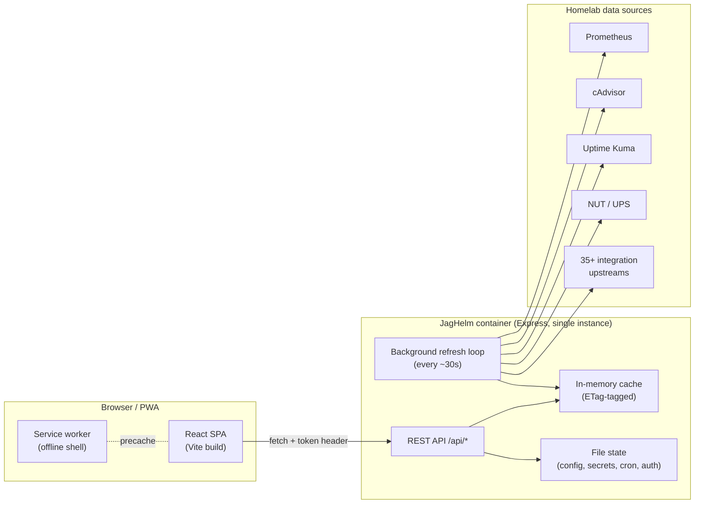
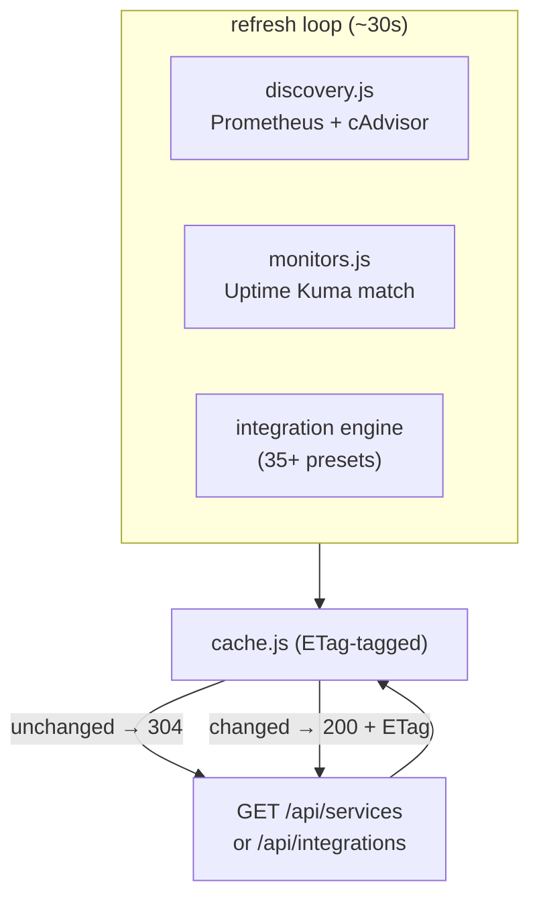
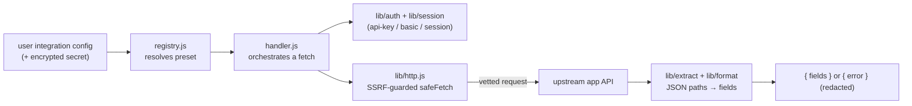
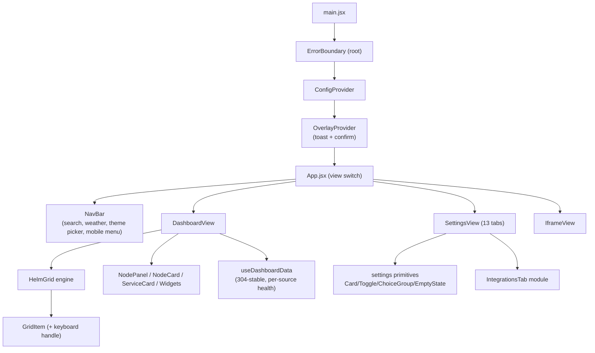
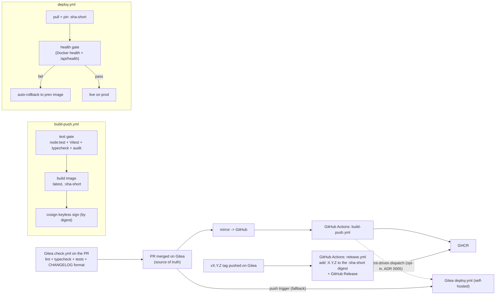

# JagHelm — Architecture

JagHelm is a self-hosted homelab dashboard whose differentiator is **live data,
not just links**: it renders real Prometheus / cAdvisor metrics and pulls live
state from 35+ service integrations, laid out on a custom drag-and-resize grid.
It is **single-user, single-instance, and file-backed** (no database), and ships
as a Docker image to a homelab.

> Reflects `main` as of v1.2.0. For *why* specific decisions were made, see the
> ADRs in [`docs/adr/`](adr/). For limitations and scope, see
> [`KNOWN-ISSUES.md`](../KNOWN-ISSUES.md). For the change history, see
> [`CHANGELOG.md`](../CHANGELOG.md).

## 1. Design philosophy

- **Live data over static links.** The point of difference vs Homepage/Dashy is
  that panels show *current* numbers (CPU, RAM, queue depth, block-rate) fetched
  server-side, not just bookmarks.
- **Single instance, in-memory, file-backed.** Sessions live in a `Map`, the
  refresh loop runs in-process, and all user state is a handful of files under a
  data dir. Simple to run; deliberately not horizontally scalable
  ([ADR 0002](adr/0002-in-memory-single-instance.md)).
- **Server does the talking.** The browser only ever calls JagHelm's own API; the
  server fans out to Prometheus, cAdvisor, Uptime Kuma, a NUT exporter, and the
  integration upstreams. Credentials never reach the client.
- **Safe by construction.** Outbound requests pass a single SSRF-guarded fetch
  chokepoint; secrets are encrypted at rest; writes are atomic; config is
  copy-on-read.

## 2. System topology



The browser talks **only** to `/api/*`. A background loop refreshes upstream data
on an interval into an in-memory cache, so API reads are fast and ETag-enabled
(304s on unchanged data). The deploy chain is separate — see §7.

## 3. Repository layout

```
server/                     Express API (Node 26, ESM)
  index.js                  app wiring: middleware chain + route mounts + SPA fallback
  refresh.js                background refresh loop (start/stop)
  cache.js                  bounded in-memory cache (evicts least recently written, ETags)
  discovery.js              Prometheus/cAdvisor -> nodes + services
                            (ignores containers labelled as Arcane internal helpers, so
                            short-lived helpers never become cards or presence breadcrumbs)
  monitors.js               Uptime Kuma monitor matching
  icons.js                  icon picker search index: names only, persisted in the data dir,
                            refreshed from GitHub by the first search when a day old (see 6)
  icon-cache.js             public /api/icons/cached: icon-repository icons on disk, size-capped
                            with LRU eviction (see 6)
  icon-sources.js           the icon repositories it may fetch from; the web client imports it too
  config.js                 services.yaml: load, hot-reload watch, copy-on-read + atomic save
  secrets.js                AES-256-GCM secret store (per-install KDF salt)
  cron-store.js             cron history (bounded)
  errors.js                 apiError + global JSON error handler
  version.js                single source of version (reads package.json)
  metrics.js                prom-client registry + middleware + /metrics handler
  accessLog.js              one JSON log line per request (full path, no query string)
  demo.js                   DEMO_MODE read-only sample dashboard
  auth/                     scrypt passwords, in-memory sessions, login rate limit, middleware
  routes/                   one router per resource (see 4.1)
  arcane/                   Arcane poller: read-only API client, state derivation, push builders,
                            persisted state, dry-run module (see 4.2)
  integrations/             the integration engine (presets + handler + lib, see 4.3)
  util/                     logger, ssrf, redact, rateLimiter, atomicWrite,
                            configSchema (zod), dataDir, asyncHandler, dedupe

src/                        React 19 SPA (Vite 8)
  main.jsx, App.jsx         providers (Config, Overlay) + ErrorBoundary + view switch
  api/client.js             apiFetch -- explicit auth-injecting fetch wrapper
  context/                  ConfigContext (config + update via setIn), OverlayContext (toast/confirm)
  hooks/useData.js          fetchJson (304-aware), weather, search engines
  utils/setIn.js            immutable structural-sharing deep-set
  components/HelmGrid/       custom grid engine (gridMath, GridItem, HelmGrid)
  components/settings/       shared primitives + 13 settings tabs (+ IntegrationsTab module)
  components/                NodeCard, ServiceCard, Widgets, NavBar, overlays, etc.
  views/DashboardView/       grid + panels + useDashboardData (304-stable) + per-source health
  views/SettingsView.jsx     13-tab settings shell + collapsible live preview
  styles/global.css          themes (10) + design tokens + component styles

public/sw.js                service worker (precache injected at build)
scripts/                    inject-sw-precache.mjs, check-assets.mjs, changelog-lint.mjs,
                            changelog-fold.mjs, release-notes.mjs (build/CI/release helpers)
changes/                    CHANGELOG fragments, one per PR (mobile/changes/ for Android);
                            the release PR folds them into the CHANGELOG (RELEASING.md)
.github/workflows/          build-push.yml (test -> build -> sign -> GHCR), release.yml (tag ->
                            promote by digest -> GitHub Release), build-apk.yml (signed APK)
.gitea/workflows/           check.yml (PR gate), deploy.yml (pin -> health-gate -> rollback)
docs/adr/                   architecture decision records (0001-0005)
```

## 4. Backend architecture

### 4.1 Express server & middleware chain

`server/index.js` wires the app in order: Prometheus metrics middleware -> request
logger -> Helmet security headers + **Content-Security-Policy (report-only)** ->
CORS -> `express.json({ limit: '1mb' })` -> `/uploads` static -> `/metrics` ->
(optional `DEMO_MODE` middleware) -> the API routers -> hashed-asset static
(`immutable, 1y`) -> SPA fallback (`index.html`) -> the global JSON error handler.
It listens on `JAGHELM_HOST` (default `0.0.0.0`, every IPv4 interface) and `PORT`
(default 3099); if it can't (an address the machine doesn't have, a port in use),
it logs `cannot listen` and exits 1.

Routers (each `server/routes/*.js`), mounted under `/api`:

| Mount | Auth | Purpose |
|-------|------|---------|
| `/api/auth` | public | login, logout, auth-status |
| `/api/health`, `/api/readyz` | public | liveness / readiness probes |
| `/metrics` | public | Prometheus exposition |
| `/api/services` | token | discovered nodes + services (background-refreshed, ETag) |
| `/api/integrations` | token | per-integration live data (background-refreshed, ETag) |
| `/api/display-config` | token | the display config blob |
| `/api/secrets` | token + **auth-required** | encrypted credential store (fail-closed) |
| `/api/cron`, `/api/todos`, `/api/upload`, `/api/icons` | token | widgets + asset upload |
| `/api/icons/cached` | public | icon-repository icons from the local icon cache (an `` can't send the token; see 6) |
| `/api/...` (infrastructure) | token | UPS, Gitea activity, etc., read from the refresh loop |

Auth is a **header token**, not a cookie (so permissive CORS is not a CSRF
vector). `/api/secrets` additionally goes through `requireAuthEnabled` -- it
returns 403 when no password is set, so an open instance can't enumerate
credentials ([KNOWN-ISSUES](../KNOWN-ISSUES.md) covers the open-by-default model).

### 4.2 Background refresh & cache

`refresh.js` runs a single in-process interval that re-fetches node/service
metrics and every configured integration into the bounded `cache.js`
(it evicts the least recently written key at max entries, so user-influenced
keys can't exhaust memory). API reads serve from the cache and attach an ETag;
an unchanged poll returns `304`.
Each cached value is serialized and hashed once, on its first request, and kept
with it, so later requests (`200` or `304`) only send what is already in memory
until the next refresh replaces the value.
`If-None-Match` is matched per RFC 9110: weak comparison, a list of tags, or `*`.
The loop is cancelled cleanly on shutdown (no leaking timer).



`server/arcane/` adds a second, independent loop when `ARCANE_URL` and `ARCANE_API_KEY` are
set (never in demo mode): `startArcane()` runs from `boot()` and polls the Arcane manager
every `ARCANE_POLL_SECONDS` (default 300) plus a release check every
`ARCANE_RELEASE_CHECK_HOURS` (default 6). With FCM credentials configured, the first poll and
release check wait up to 30 s for push to be ready. It diffs against persisted state and emits
push events through `dispatchEvents`, and records Arcane's scheduler-started update and prune
runs, and its image watcher's checks, into the cron store. On its own weekly timer it also
reads Arcane's stored vulnerability scan results for the environments in
`ARCANE_VULN_DIGEST_ENVS` and pushes a digest per environment when something is new
(`arcane_vulns`), recording each digest as the `arcane-vuln-digest` cron job. Its `arcane_*` push types map to the `watchtower` preference category (labelled Updates
in the app). Setup: [arcane/SETUP.md](arcane/SETUP.md).

### 4.3 Integration engine

The differentiator. A declarative **preset** (`integrations/presets/*.js`, one
file per app) describes how to talk to one app: endpoints, auth mode, and which
JSON paths map to which display fields. The registry loads every `.js` file in
`presets/` except `*.test.js`, so helpers the presets share live in `lib/`
(e.g. `lib/createArrPreset.js`). A preset flagged `unsupported` still loads, so
an existing config that names it resolves, but `listPresets()` leaves it out of
the gallery and it can't be added; the docs count only the 35+ a user can add.
The flow:



Key properties:

- **One guarded chokepoint.** Every outbound request goes through
  `lib/http.js` `safeFetch`, which calls `assertSafeUrl` (`util/ssrf.js`) by
  construction -- blocking cloud-metadata IPs, decimal/hex/octal IPv4, and
  IPv4-mapped IPv6, with a `trusted` flag exempting operator infra (Prometheus/
  Kuma) from the strict private-network block.
- **Credential headers stay on their origin.** Redirects are followed in code
  (`util/safeFetchCore.js`), and a hop to a different origin (scheme, host or
  port) forwards only `Accept`, `Accept-Encoding`, `Content-Type` and
  `User-Agent`. Every other header, so every preset's auth header, is dropped
  and stays dropped for the rest of the chain. The one exception is an
  `http://` to `https://` upgrade on the same host and port (a reverse proxy's
  force-SSL), which keeps them because they were just sent to that host. Both
  cases are logged once per origin pair, with header names and no values.
- **Credentials in the URL stay on their origin too.** A key in the query
  string (SABnzbd, Tautulli, Emby) or a credential filled into a custom
  endpoint's `{token}`, `{password}` or `{username}` can't be stripped from a
  redirect, so the code that builds such a URL (`applyQueryAuth` in
  `handler.js`, `resolveEndpoint` in `lib/extract.js`) passes
  `credentialInUrl`, and the request refuses any redirect to another origin
  with an error telling the user to configure the final URL. The same-host
  `http://` to `https://` upgrade is still followed, and logged once per
  origin pair like a header-carrying one, since the key went out in clear
  text first. `httpClient.js` `safeFetch` accepts the same option.
- **Request bodies stay on their origin.** A `307` or `308` keeps the method
  and body, so a session login is re-sent, but only to the same origin or
  through the same-host upgrade; a request with a body redirected to another
  origin is refused, so a username and password never reach a host the user
  didn't configure. Refusals, and an upgrade that re-sends a body, are logged
  once per origin pair without values. A streamed body can't be re-sent and is
  refused too. A
  `303`, and a `301`/`302` on any method but `GET`/`HEAD`, becomes a `GET`
  without a body.
- **Credentials are redacted** (`util/redact.js`) before any error is logged *or*
  returned to the browser -- query-auth presets put the key in the URL, which
  fetch errors would otherwise echo.
- **Only the computed result is kept.** A poll returns what the preset
  computes (its fields, plus structured data such as Proxmox's VMs, storage
  pools and last backup), and drops the upstream response once the preset has
  read it. No route returns an integration's upstream response.
- **Session-auth presets** (Nginx Proxy Manager, Portainer, PhotoPrism) get a
  managed login session via `lib/session.js`; the same SSRF guard still applies.

### 4.4 Config, secrets, and persistence

- **Display config** (`config.js`) is **copy-on-read** (`getConfig()` returns a
  `structuredClone`) and saved via a synchronous **atomic** write
  (temp -> fsync -> rename), so a route can't mutate shared state and a crash
  can't truncate the file ([ADR 0001](adr/0001-atomic-file-writes.md),
  [ADR 0004](adr/0004-config-copy-on-read.md)). It is validated against a Zod
  schema (`util/configSchema.js`) on read, so a malformed file fails loudly.
- **Secrets** (`secrets.js`) are AES-256-GCM encrypted with a **per-install
  random KDF salt** (`data/.secrets-salt`, legacy-static-salt fallback). All
  credential stores write `0600`.
- **Data dir** is single-sourced via `util/dataDir.js` (`JAGHELM_DATA_DIR`) so
  secrets/auth/config/cron and the icon cache never split across locations.

### 4.5 Auth & rate limiting

scrypt password hashing (`auth/passwords.js`), in-memory sessions
(`auth/sessions.js`), and a brute-force **login rate limiter** (`auth/rateLimit.js`).
A reusable `util/rateLimiter.js` additionally throttles the abuse-prone
integration connection-test endpoint.

### 4.6 Observability

- **Structured logging** (`util/logger.js`) with redaction -- no secrets in logs.
  `LOG_LEVEL` (`debug|info|warn|error|silent`, default `info`) filters it.
  Success lines every refresh cycle would repeat are debug, while a refresh
  that keeps failing still logs its own error each cycle. At info: a cycle that
  took 5 s or more; a change in the cycle's set of failed refreshes (a refresh
  that returned null, or an integration with an `_error`; a Prometheus outage
  does not show up here, since node and UPS queries swallow their errors); a
  Kuma load whose monitor count or source changed, or the first load after a
  failed one; and one line per boot for containers no monitor matches. Kuma
  answering with no monitors warns once per outage; a Kuma that can't be
  reached logs an error every cycle.
- **Access log** (`accessLog.js`): one line per request with its full path and no
  query string or fragment; 5xx at `error`, 4xx and requests of 300 ms or more at
  `info`, the rest at `debug`. `/metrics`, `/api/health` and `/api/readyz` are not
  logged unless they fail (5xx).
- **Prometheus metrics** at `/metrics` via `prom-client` (`metrics.js`): request
  rate, latency histograms, refresh-loop health.
- **Two probes**: `/api/health` (liveness; reflects refresh-loop liveness -- 503
  when wedged) and `/api/readyz` (readiness; distinguishes "not ready yet" from
  "down"), backing the Docker `HEALTHCHECK` and the deploy gate.

## 5. Frontend architecture



- **State.** `ConfigContext` exposes `config`, the stable `setConfig`, and a
  memoised `update(path, value)` built on `setIn` (immutable structural-sharing
  deep-set) -- so leaf cards memoise and don't re-render on unrelated edits.
  `OverlayContext` provides `useToast` / `useConfirm` (focus-trapped, Escape,
  focus-restore, reduced-motion). `api/client.js` `apiFetch` injects the auth
  token explicitly (replacing an old `window.fetch` monkey-patch).
- **HelmGrid** is a custom, dependency-light layout engine: pure math in
  `gridMath.js` (snap, overlap-resolve, content-fit), per-item measurement +
  rendering in `GridItem.jsx`, and lifecycle (breakpoints, drag/resize, commit)
  in `HelmGrid.jsx`. Panels auto-grow to fit content; pointer **and keyboard**
  (arrow move / Shift+arrow resize, with a live region) reposition them.
- **Data fetching.** `useDashboardData` holds a **304-stable identity contract**:
  on an unchanged poll `fetchJson` returns the same reference and `setState`
  bails via `Object.is`, so an all-304 tick triggers zero re-renders. Per-source
  health (error / stale / retry) is derived at render without per-tick state.
- **Design system.** 10 themes (`themes.js` + `[data-theme]` token blocks),
  generic `--space-*` / `--text-*` scales plus semantic `--fs-*` card tokens,
  and a global `:focus-visible` ring + reduced-motion handling.
- **PWA.** `public/sw.js` precaches the app shell **and** the hashed first-paint
  bundles (the precache list + version are injected at build by
  `scripts/inject-sw-precache.mjs`); immutable `/assets/` are served cache-first.

## 6. Data model

All state is files under the data dir (no DB):

- **services.yaml** -- nodes, per-service overrides and integration configs
  (each secret value stored separately, encrypted). Hot-reloaded on an
  external edit; read copy-on-read; `POST /api/services/config` validated by Zod.
- **display config** -- title, theme, layout (`{lg,md,sm}` grid item arrays),
  sections (per-panel visibility/order/colour), nav/search/weather flags,
  links, tabs, fonts. Read copy-on-read; validated by Zod.
- **secrets** -- AES-256-GCM blob, keyed by integration storage key.
- **Arcane state** -- `arcane-state.json` (baselined environments, agent down counters,
  seen activity ids, each environment's pending updates, runs waiting on their job run,
  last notified release),
  `arcane-held-back.json` (held-back containers per environment) and
  `arcane-vuln-state.json` (each environment's critical/high finding keys, KEV count and
  stale or failed images at the last vulnerability digest, and when it last ran); atomic writes, tolerant load.
- **cron history**, **todos**, **auth** (password hash + salt) -- small files,
  atomic writes.
- **icon index** -- `icon-index.json`: the SVG names of the two icon repositories
  (homarr-labs/dashboard-icons, selfhst/icons) with each listing's ETag and when
  it was last checked; about 170 KB, atomic writes, tolerant load. A cache, so
  deleting it is safe. Boot only reads it and never calls GitHub; the first icon
  search after it is missing or a day old lists each repository's `svg/`
  directory on its default branch (conditional on the ETag, 8 MB body cap). A
  failed or truncated refresh keeps the index it has and is retried after an
  hour, or after 5 minutes while there is no index to serve.
- **icon cache** -- `icon-cache/`: each icon `/api/icons/cached` has served, one
  file named by the SHA-256 of its canonical URL. The route is public, so it
  fetches only icons of the two icon repositories (Dashboard Icons, selfh.st) as
  SVG, PNG or WebP at a moving ref, on jsDelivr or raw.githubusercontent.com
  (`icon-sources.js`); it rebuilds the URL from that allowlist, so a query string
  or another spelling of one icon is the same file, and follows a redirect only to
  another such URL. An icon must be the image type its extension names and at
  most 512 KB; a larger one is not cached and the browser is redirected to the
  CDN for it. The whole cache is capped at `JAGHELM_ICON_CACHE_MAX_MB` (50 MB)
  and drops the least recently used icon to stay under it; the files on disk
  are counted at boot, oldest written first, and the count is kept in memory.
  At most 8 fetches from the CDN run at once (a browser opens 6 connections to an
  HTTP/1.1 origin, so one page load never waits) and 256 more wait; past that a
  miss is a 503 with `Retry-After`. Concurrent requests for one icon share one
  fetch. A body is held only until it is written; every response, a miss's
  too, streams from the file, and one that wasn't stored is a 302 to the CDN,
  so icon bodies in memory stay under 4 MB.
  Served with `Content-Security-Policy: default-src 'none'; style-src
  'unsafe-inline'; sandbox` and `nosniff`. The web client sends only these URLs
  through it and loads any other icon URL directly. A cache, so deleting it is
  safe; icons are fetched again as they are shown.

## 7. CI/CD pipeline



- **PR gate** ([check.yml](../.gitea/workflows/check.yml)) runs on the
  self-hosted Gitea runner for every PR to `main`: secret scan, CHANGELOG
  format (both CHANGELOGs and their `changes/` fragments), lint, typecheck,
  server, web and mobile tests, and the asset check.
- **Build** ([build-push.yml](../.github/workflows/build-push.yml)) runs on
  GitHub for every push to `main`: a test gate (so a red `main` can't ship),
  then build and push `:latest` and the immutable `:sha-<short>` with OCI
  labels, then **keyless cosign signing**.
- **Server release** ([release.yml](../.github/workflows/release.yml)) runs on
  GitHub when a `vX.Y.Z` tag arrives from Gitea. It does not rebuild: it checks
  the tag (on `main`, matching `package.json` and a CHANGELOG section), waits for
  that commit's `:sha-<short>`, verifies its signature, adds `:X.Y.Z` to the same
  digest, and creates the GitHub Release from the CHANGELOG. Published image tags
  never move and release pages are never rewritten. Procedure:
  [RELEASING.md](RELEASING.md).
- **Android release** ([build-apk.yml](../.github/workflows/build-apk.yml)) runs
  on GitHub for a `mobile-vX.Y.Z` tag: it builds and signs the APK, then a
  release job attaches it to a GitHub Release with notes from
  `mobile/CHANGELOG.md`. A manual run is a
  test build and creates no release.
- **Deploy** ([deploy.yml](../.gitea/workflows/deploy.yml)) runs on the
  self-hosted Gitea runner labelled `vm103` (no other workflow may use that
  label): pull and **pin this commit's `:sha-<short>`** image,
  recreate behind a **health gate** that auto-rolls-back to the previous image on
  failure.
- **Event-driven trigger** ([ADR 0005](adr/0005-event-driven-deploy.md)): the
  build dispatches the deploy when the image is ready, replacing a GHCR poll. It
  is opt-in and fallback-preserving -- the push trigger remains until verified.

## 8. Testing

Automated tests gate every PR to `main` (`check.yml`) and every build of `main`
(`build-push.yml`):

- **Backend** (`node --test`, `npm run test:ci`): the AES-GCM secrets round-trip +
  tamper, the SSRF guard vectors, credential redaction, the upload allowlist,
  config schema/copy-on-read (incl. a `SIGKILL`-mid-write chaos test), route
  contracts, rate limiting, `/health` + `/readyz`, and the pure HelmGrid
  `gridMath` + service-worker precache injector.
- **Client** (`npm run test:client`, Vitest + jsdom + React Testing Library):
  NavBar/config-driven rendering, settings primitives, the keyboard grid handle,
  per-source health banners, overlay/confirm semantics, and the 304-stable data
  hook.
- **Mobile** (`npm run test:mobile`, Vitest): the Android app's views, login,
  push routing and on-device storage.
- **Repo guards** (`node --test`, `scripts/*.test.mjs`): the deploy runner pin,
  the secret floor (`.gitignore`, tracked templates, the scanner catching a
  planted key) and its wiring in `check.yml`, and the docs' preset and test
  counts (`doc-counts.test.mjs`). Write new repo checks this way, not as shell
  scripts: `npm test` only collects `*.test.{js,mjs,cjs}`.

`npm test` preloads `scripts/test-data-dir.mjs`, which gives every test process
its own temp `JAGHELM_DATA_DIR`, so the suite never reads or writes the
checkout's `data/` (`scripts/test-data-dir.test.mjs` guards the wiring).

It also preloads `scripts/test-exit-guard.mjs`. From Node 26, `--test-timeout`
bounds each test but no longer a test file's process, so a file that leaves a
server, interval or socket open would keep `npm test` running forever. The
guard fails such a file once it is still running `--test-timeout` ms after its
last test (`scripts/test-exit-guard.test.mjs`).

The Vitest configs (`vite.config.js`, `mobile/vite.config.mobile.js`) start
their workers with `--no-experimental-webstorage`: Node 25 and later ship a
`localStorage` global of their own, which hides jsdom's.

`npm run test:ci` also fails a run that passes fewer backend tests than the
floor in `scripts/test-floor.mjs`, so a silently dropped test is caught. The
docs give no exact test or preset count, since one goes stale with the next
change; `doc-counts.test.mjs` fails on one.

## 9. Key decisions (ADRs)

| ADR | Decision |
|-----|----------|
| [0001](adr/0001-atomic-file-writes.md) | Atomic temp->fsync->rename writes for all user state |
| [0002](adr/0002-in-memory-single-instance.md) | Single-instance, in-memory state (no DB) |
| [0003](adr/0003-scoped-tls-bypass.md) | Per-request, opt-in TLS-verify bypass for self-signed infra |
| [0004](adr/0004-config-copy-on-read.md) | Config is copy-on-read + synchronous atomic writes |
| [0005](adr/0005-event-driven-deploy.md) | Event-driven build->deploy trigger (opt-in, fallback-preserving) |

## 10. Known tradeoffs

Single-instance / in-memory (no clustering), single-user / single-tenant, and a
hard Prometheus dependency for node metrics are **deliberate scope choices**, not
bugs. The full list -- security defaults (open-by-default, host networking),
integration drift, and roadmap items -- lives in
[`KNOWN-ISSUES.md`](../KNOWN-ISSUES.md).
